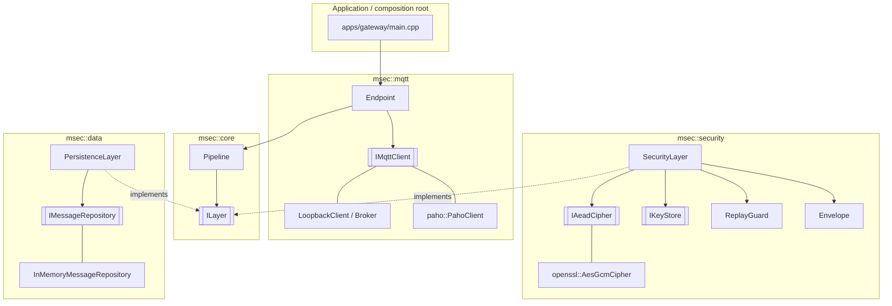

# mqtt-secure

Layered security architecture for MQTT-based IoT communication, C++23.

## Build

```bash
cmake --preset dev        # Debug + ASan/UBSan   (also: tsan, release, ci)
cmake --build --preset dev
ctest --preset dev
./build/dev/apps/gateway/msec_gateway_demo
```

Requires CMake ≥ 3.25, GCC ≥ 13 or Clang ≥ 17, OpenSSL ≥ 3.0, Ninja, and
Eclipse Paho MQTT C++ (`libpaho-mqttpp-dev`; `-DMSEC_WITH_PAHO=OFF` to build without it).
The load lab also needs Mosquitto (`mosquitto`, `mosquitto_passwd`) and Python ≥ 3.11.

ThreadSanitizer with GCC 13 fails on kernels with high mmap randomisation
("unexpected memory mapping"); run the `tsan` preset under `setarch $(uname -m) -R`.
GoogleTest is used from the system if present, otherwise fetched (hash-pinned).

## Benchmarks

Cost of each security level, end to end (publish → pipelines → loopback broker → app):

```bash
cmake --preset bench && cmake --build --preset bench
./build/bench/benchmarks/msec_pipeline_benchmarks --benchmark_counters_tabular=true
# stable numbers: --benchmark_repetitions=10 --benchmark_report_aggregates_only=true
# machine-readable: --benchmark_out=results.json --benchmark_out_format=json
```

| Profile                  | Pipeline (gateway side)          | Adds                                               |
|--------------------------|----------------------------------|----------------------------------------------------|
| `0_baseline`             | none                             | —                                                  |
| `1_persistence_only`     | persistence                      | storage cost                                       |
| `2_auth_only`            | security, `AuthenticateOnly`     | integrity + topic binding (GMAC), payload readable |
| `3_aead`                 | security, freshness & replay off | + confidentiality                                  |
| `4_aead_freshness`       | + freshness                      | stale-message rejection                            |
| `5_aead_replay`          | + replay guard                   | replay rejection                                   |
| `6_full`                 | security, defaults               | everything                                         |
| `7_full_persist_plain`   | `[persistence, security]`        | stores plaintext                                   |
| `8_full_persist_at_rest` | `[security, persistence]`        | stores envelopes                                   |

Every profile runs in three topic zones (benchmark name `zone/profile/payload:N`):

| Zone | Broker | Topics |
|---|---|---|
| `noacl` | no ACL | `open/sensors/...` |
| `open` | ACL, `open/#` readable & writable by every client | `open/sensors/...` |
| `restricted` | ACL, only `sensor-1` writes, only `gateway` reads | `restricted/sensors/...` |

An eavesdropper (`mallory`) stays subscribed to `#` throughout, so wildcard
fan-out is part of the cost wherever the ACL lets it through.

Each profile runs at 16 B, 256 B, 4 KiB and 64 KiB payloads. Besides time and
throughput, every row reports `wire_B` / `overhead_B`, `leak` (fraction of
messages the `#` subscriber received) and results of an attack probe run before
timing: `confid` (attacker cannot read the payload), `replay`, `tamper`,
`rebind`, `inject` (attack stopped) and `by_acl` (how many of the 4 attacks the
broker stopped before the gateway pipeline was even involved).

The benchmark pins glibc's allocator (no heap trimming) so results don't depend
on run order; `MSEC_BENCH_DEFAULT_MALLOC=1` measures with the defaults.

Scope: the loopback broker is in-process and synchronous, so this measures the
CPU cost of the layers only. TLS / broker authentication (defence layer 1) and
network latency are not covered yet.

## Load lab: every feature switchable, live

`tools/loadgen` runs a complete system on one machine and lets you switch every
security feature on or off, from a config file at startup or **while traffic flows**:

```
mock sensors (Python) ─▶ private mosquitto ─▶ msec_load_gateway ─▶ metrics
                               ▲
              attacker ────────┘  subscribes to '#', injects, replays, impersonates
```

| Setting | Values | Applied live by |
|---|---|---|
| `transport.mode` | `plain` · `tls` · `mtls` | broker restart with only that listener; all clients reconnect |
| `transport.auth` | on/off (username + password) | broker reload (`SIGHUP`); clients without valid credentials are dropped |
| `transport.acl` | on/off (`open/#` for all, `restricted/` per client) | broker reload, effective on the next message |
| `payload.protection` | `none` · `auth_only` · `encrypt` | gateway pipeline switch + sensors |
| `payload.freshness`, `payload.replay` | on/off | gateway pipeline switch |
| `storage.persistence` | `none` · `plain` · `at-rest` | gateway pipeline switch |
| `load.rate`, `load.payload`, `load.zone` | numbers / `open` · `restricted` | sensors |
| `attacker.*` | `enabled`, `impersonate`, `inject_rate`, `replay_rate` | attacker |
| `load.sensors`, `load.processes`, `load.qos`, `broker.*` | | startup only |

Every setting and its default is documented in `tools/loadgen/lab.example.toml`.

Setup (once):

```bash
cmake --preset bench && cmake --build --preset bench
python3 -m venv tools/loadgen/.venv
tools/loadgen/.venv/bin/pip install -r tools/loadgen/requirements.txt
```

**Live dashboard**: flip switches and watch throughput, latency, CPU, rejections
(by reason) and what the attacker achieves, with every change marked on the charts:

```bash
tools/loadgen/.venv/bin/python tools/loadgen/loadgen.py live \
    --config tools/loadgen/lab.example.toml --set load.sensors=100
# open http://127.0.0.1:8088/   — or drive it from a script:
curl -s localhost:8088/api/config -d '{"transport": {"mode": "mtls", "auth": true}}'
```

**Matrix**: apply each combination in turn and measure a window per cell
(cartesian product of `--vary`; startup-only settings start a fresh lab):

```bash
tools/loadgen/.venv/bin/python tools/loadgen/loadgen.py matrix \
    --set load.sensors=100 --set load.rate=100 \
    --vary transport.mode=plain,tls,mtls --vary transport.auth=off,on \
    --vary payload.protection=none,auth_only,encrypt --settle 3 --duration 10
```

Columns: offered vs. delivered msg/s, `loss_pct`, `rejected`, `leak_pct` (share
the attacker received via `#`), `forged_ok` / `replays_ok` (attacks the gateway
accepted), latency p50/p99 (sensor send → after the gateway pipeline), gateway
CPU % and µs per message, broker CPU %. Results go to `build/loadtest/`.

How it works:

- A fresh test PKI is generated per run (`pki.py`): a CA, a broker certificate
  for `localhost`/`127.0.0.1`, and a certificate, password and payload key per
  client. The attacker gets only the public CA certificate.
- Legitimate clients always present their credentials, so switching
  authentication never interrupts them; only the attacker gets dropped.
- With `mtls` the certificate CN is the MQTT username (`use_identity_as_username`),
  so ACL rules (`%u`) bind to the certificate. Without auth or mtls a username is
  only a claim: try `attacker.impersonate` with the ACL on.
- The gateway (`msec_load_gateway`) is controlled over stdin (`set <key> <value>`,
  `reconnect`, `reset`, `summary`) and reports JSON lines; its pipeline holds
  every layer from the start inside `SwitchableLayer`s, so no switch rebuilds it.
- Everything shares one machine, so absolute numbers include the Python sensors
  competing for CPU. `loss_pct` and `leak_pct` are accurate to about ±0.5 s of
  the window (sensors report twice a second).

## Architecture



### Topic zones and ACL

`mqtt::AccessControlList` (Mosquitto `acl_file` semantics, deny by default) can
be passed to `LoopbackBroker::create()`. Publishing needs Write access
(`PermissionDenied` otherwise); Read access is checked per message at delivery,
so a client subscribed to `#` only receives the topics it may read. The demo
uses two zones: `open/#` for everyone and `restricted/` for sensor → gateway.
Rules are keyed by client id, which is only a claim until broker authentication
(TLS client certs / passwords) is in place.

### Module dependency rule

```
core  ◀── mqtt
core  ◀── security
core  ◀── data
apps  ──▶ everything (composition root)
```

Modules depend **only on `core`**, never on each other. `mqtt` does not know
that security exists; `security` does not know about MQTT clients. They meet
through the `ILayer` / `Message` abstractions, and only `main.cpp` wires
concrete classes together (dependency injection, no globals, no singletons).

### The pipeline

Layers are ordered from the application side down to the transport side.
Outbound messages travel top-down, inbound messages bottom-up:

```
application ──outbound──▶ [persistence] ▶ [security] ──▶ MQTT
application ◀──inbound─── [persistence] ◀ [security] ◀── MQTT
```

Any layer can transform, observe or **reject** a message. A rejection stops
processing; on inbound the message is dropped, logged and counted in
`EndpointStats::rejected_inbound`, so it never reaches the application.

Order is a design decision, not an accident: `[persistence, security]`
stores decrypted data; `[security, persistence]` stores the encrypted
envelopes (encryption at rest).

Pipelines are immutable once built. A feature that must be switchable at
runtime is added up front and wrapped in `msec::SwitchableLayer`, which passes
messages through untouched while disabled (one atomic flag, safe to flip from
any thread). `SecurityLayer` additionally exposes `set_protection`,
`set_enforce_freshness` and `set_enforce_replay_protection`; its replay window
keeps its state across changes.

### Adding a layer

1. `modules/<name>/include/msec/<name>/<name>_layer.hpp`: implement `msec::ILayer`.
2. `modules/<name>/CMakeLists.txt`:
   ```cmake
   msec_add_module(NAME <name> SOURCES src/<name>_layer.cpp PUBLIC_DEPS msec::core)
   ```
3. `add_subdirectory(modules/<name>)` in the root `CMakeLists.txt`.
4. `.add(...)` it in the pipeline in `main.cpp`.

Candidate layers: rate limiting / DoS protection, schema validation,
access control (topic ACLs), audit log, compression (place it *above*
security: compressing ciphertext is useless and compress-then-encrypt can
leak information, see CRIME/BREACH, so think about whether you want it at all).

## Security design

Two independent layers of protection (defence in depth):

| Layer | Mechanism | Protects against |
|---|---|---|
| Transport | TLS (`ConnectionOptions::tls`, mutual TLS) | network eavesdropping, MITM to broker |
| Payload (`SecurityLayer`) | AES-256-GCM AEAD, end-to-end | a **compromised or curious broker**, rogue subscribers |

The payload layer works even if the broker is untrusted, which TLS alone
cannot provide since TLS terminates at the broker.

### Envelope format (big-endian)

```
| "MS" | ver | key id (4) | sequence (8) | timestamp ms (8) | N | nonce (N) | ciphertext ‖ tag |
|<───────────────── authenticated as associated data (+ MQTT topic) ─────────────────>|
```

### Threats addressed

| Threat | Countermeasure | Test |
|---|---|---|
| Eavesdropping | AEAD encryption | `RoundTripHidesPlaintext` |
| Payload tampering | GCM tag | `RejectsTamperedCiphertext` |
| Header tampering | header in AAD | `RejectsTamperedHeader` |
| Re-publishing to another topic | topic in AAD | `RejectsTopicRebinding` |
| Replay | sequence numbers + 64-entry sliding window (RFC 4303) | `RejectsReplay` |
| Delayed / pre-recorded messages | timestamp freshness window | `RejectsExpiredMessages` |
| Forged plaintext injection | envelope parse + authentication | `AttackerCannotReplayOrInject` |
| Compromised device | per-device key ids + revocation | `RejectsRevokedKey` |
| Memory exhaustion via fake senders | bounded `ReplayGuard`, bounded repository | `KeysAreIndependentAndBounded` |
| Decryption oracle | uniform `AuthenticationFailed`; replay state updated only after auth | — |

### Known limitations (honest list for the report)

- **Key distribution** is out of scope: keys are pre-shared. Next step:
  provisioning, rotation, or an ECDH handshake per device.
- **Sequence counters are not persisted.** A sender restart restarts at 1 and
  the receiver will reject it as a replay until the window is passed. Fix:
  persist the counter, or add an epoch/session id to the header.
- **Receiver restart forgets replay state.** The freshness window bounds this
  exposure to `max_message_age`.
- **Random 96-bit nonces** are safe for roughly 2³² messages per key. For
  long-lived keys, rotate or switch to XChaCha20-Poly1305.
- **One key = one sender.** Sharing a key across devices breaks the replay window.
- The loopback broker is a test double; a real `IMqttClient` adapter
  (Eclipse Paho C++ or libmosquitto) is the next step.

## Engineering practices

- Errors are values: `std::expected` (`Result<T>` / `Status`) everywhere; no
  exceptions cross module boundaries; every result is `[[nodiscard]]`.
- Invalid states are unrepresentable: `Topic` can only be built validated;
  layers are built through factories that check their dependencies.
- RAII for all resources; secrets live in `SecureBuffer` (non-copyable,
  zeroed on destruction); plaintext is wiped after encryption.
- Interfaces are non-copyable/non-movable (no slicing); concrete classes `final`.
- All external effects injected (clock, RNG, transport, storage) → deterministic tests.
- Bounded memory everywhere attacker input can create state.
- Compiler: `-Wall -Wextra -Wpedantic -Wconversion -Wsign-conversion …
  -Werror`, plus `_FORTIFY_SOURCE=3`, stack protector, full RELRO, bounds-checked
  `std` containers (`_GLIBCXX_ASSERTIONS`).
- Verified under ASan + UBSan, ThreadSanitizer, and clang-tidy (`ci` preset,
  CERT + C++ Core Guidelines checks).
