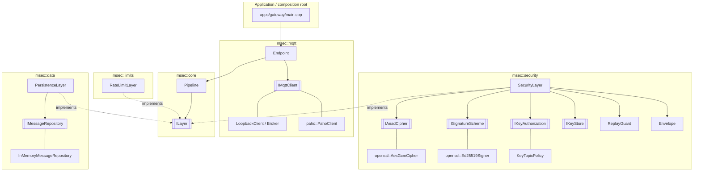

# mqtt-secure

Layered security architecture for MQTT-based IoT communication, C++23.

## Quick start

```bash
./run.sh                    # builds what is missing, starts the live lab, opens the dashboard
./run.sh --preset hardened  # the same, with every defence on
```

## Build

```bash
cmake --preset dev        # Debug + ASan/UBSan   (also: tsan, release, ci, bench, fuzz)
cmake --build --preset dev
ctest --preset dev
./build/dev/apps/gateway/msec_gateway_demo
```

Load-lab unit tests (Python, no broker needed):

```bash
tools/loadgen/.venv/bin/python -m unittest discover -s tools/loadgen/tests -t tools/loadgen
```

Fuzzing (Clang + `libclang-rt-18-dev`): `envelope::parse`, topic validation and
matching, and the whole inbound `SecurityLayer` path on arbitrary bytes.

```bash
cmake --preset fuzz && cmake --build --preset fuzz
./build/fuzz/fuzz/fuzz_security_inbound fuzz/corpus/envelope -max_total_time=60
```

`tests/vectors/envelope_vectors.txt` is checked by both the C++ tests and the
Python ones, so the two envelope implementations cannot drift apart.

Requires CMake ≥ 3.25, GCC ≥ 13 or Clang ≥ 17, OpenSSL ≥ 3.0, Ninja, and
Eclipse Paho MQTT C++ (`libpaho-mqttpp-dev`; `-DMSEC_WITH_PAHO=OFF` to build without it).
The load lab also needs Mosquitto (`mosquitto`, `mosquitto_passwd`) and Python ≥ 3.11.

ThreadSanitizer with GCC 13 fails on kernels with high mmap randomisation
("unexpected memory mapping"); run the `tsan` preset under `setarch $(uname -m) -R`.
GoogleTest is used from the system if present, otherwise fetched (hash-pinned).

## Benchmarks

Cost of each security level, end to end (publish → pipelines → loopback broker → app):

```bash
cmake --preset bench && cmake --build --preset bench
./build/bench/benchmarks/msec_pipeline_benchmarks --benchmark_counters_tabular=true
# stable numbers: --benchmark_repetitions=10 --benchmark_report_aggregates_only=true
# machine-readable: --benchmark_out=results.json --benchmark_out_format=json
```

| Profile                  | Pipeline (gateway side)          | Adds                                               |
|--------------------------|----------------------------------|----------------------------------------------------|
| `0_baseline`             | none                             | —                                                  |
| `1_persistence_only`     | persistence                      | storage cost                                       |
| `2_auth_only`            | security, `AuthenticateOnly`     | integrity + topic binding (GMAC), payload readable |
| `3_aead`                 | security, freshness & replay off | + confidentiality                                  |
| `4_aead_freshness`       | + freshness                      | stale-message rejection                            |
| `5_aead_replay`          | + replay guard                   | replay rejection                                   |
| `6_full`                 | security, defaults               | everything                                         |
| `7_full_persist_plain`   | `[persistence, security]`        | stores plaintext                                   |
| `8_full_persist_at_rest` | `[security, persistence]`        | stores envelopes                                   |
| `9_sign`                 | security, `Sign` (Ed25519)       | proof of origin; payload readable                  |
| `10_full_key_binding`    | security + `KeyTopicPolicy`      | a key may only publish on its owner's topics       |

Every profile runs in three topic zones (benchmark name `zone/profile/payload:N`):

| Zone | Broker | Topics |
|---|---|---|
| `noacl` | no ACL | `open/sensors/...` |
| `open` | ACL, `open/#` readable & writable by every client | `open/sensors/...` |
| `restricted` | ACL, only `sensor-1` writes, only `gateway` reads | `restricted/sensors/...` |

An eavesdropper (`mallory`) stays subscribed to `#` throughout, so wildcard
fan-out is part of the cost wherever the ACL lets it through.

Each profile runs at 16 B, 256 B, 4 KiB and 64 KiB payloads. Besides time and
throughput, every row reports `wire_B` / `overhead_B`, `leak` (fraction of
messages the `#` subscriber received) and results of an attack probe run before
timing: `confid` (attacker cannot read the payload), `replay`, `tamper`,
`rebind`, `inject` (attack stopped) and `by_acl` (how many of the 4 attacks the
broker stopped before the gateway pipeline was even involved).

The benchmark pins glibc's allocator (no heap trimming) so results don't depend
on run order; `MSEC_BENCH_DEFAULT_MALLOC=1` measures with the defaults.

Scope: the loopback broker is in-process and synchronous, so this measures the
CPU cost of the layers only. TLS, broker authentication and network latency are
measured by the load lab below.

Signatures are the expensive option: on the development machine `9_sign` costs
~205 µs per message end to end (sign + verify) against ~5.4 µs for `6_full`
(AES-256-GCM), at 256 B.

## Load lab: every feature switchable, live

`tools/loadgen` runs a complete system on one machine and lets you switch every
security feature on or off, from a config file at startup or **while traffic flows**:

```
mock sensors (Python) ─▶ private mosquitto ─▶ msec_load_gateway ─▶ metrics
                               ▲
              attacker ────────┘  subscribes to '#', injects, replays, impersonates
```

| Setting | Values | Applied live by |
|---|---|---|
| `transport.mode` | `plain` · `tls` · `mtls` | broker restart with only that listener; all clients reconnect |
| `transport.tls_version` | `1.2` · `1.3` | broker restart |
| `transport.protocol` | `3.1.1` · `5` (MQTT version) | every client reconnects |
| `transport.auth` | on/off (username + password) | broker reload (`SIGHUP`); clients without valid credentials are dropped |
| `transport.acl` | on/off (`open/#` for all, `restricted/` per client; off = no ACL at all, `$SYS` included) | broker reload, effective on the next message |
| `transport.clientid_binding` | on/off (`use_username_as_clientid`) | broker restart |
| `transport.sys_topics` | on/off (`$SYS/#` statistics) | broker reload |
| `transport.max_packet`, `transport.max_connections` | numbers, 0 = no limit | broker restart |
| `payload.protection` | `none` · `auth_only` · `encrypt` · `sign` | gateway pipeline switch + sensors + actuators |
| `payload.freshness`, `payload.replay` | on/off | gateway pipeline switch + actuators |
| `payload.key_binding` | on/off (a key may only publish on `+/sensors/<owner>/#`) | gateway pipeline switch |
| `payload.rate_limit` | msg/s per topic, 0 = off | gateway pipeline switch |
| `payload.key_epoch` | raise it to rotate every payload key | new keys installed, senders switch, old keys revoked 3 s later |
| `storage.persistence` | `none` · `plain` · `at-rest` | gateway pipeline switch |
| `downlink.rate` | gateway → actuator commands/s | gateway; every sensor verifies its commands |
| `response.revoked` | e.g. `"3,7"`, can only grow | gateway drops the keys, broker the passwords, CRL the certificates (mtls) |
| `load.rate`, `load.payload`, `load.zone` | numbers / `open` · `restricted` | sensors |
| `attacker.*` | `enabled`, `impersonate`, `inject_rate`, `replay_rate` | attacker |
| `load.sensors`, `load.processes`, `load.qos` (0 · 1 · 2), `broker.*` | | startup only |

Which Mosquitto (2.0.18) options apply on `SIGHUP` and which need a restart was
measured, not assumed: `sys_interval`, the password file and the ACL reload;
`use_username_as_clientid`, `max_packet_size` and listener options do not.
Listener options must come after the `listener` line, or Mosquitto silently
opens an extra default listener on 1883.

Every setting and its default is documented in `tools/loadgen/lab.example.toml`.

Setup (once):

```bash
cmake --preset bench && cmake --build --preset bench
python3 -m venv tools/loadgen/.venv
tools/loadgen/.venv/bin/pip install -r tools/loadgen/requirements.txt
```

**Live dashboard**: flip switches and watch throughput, latency, CPU, rejections
(by reason) and what the attacker achieves, with every change marked on the charts:

```bash
tools/loadgen/.venv/bin/python tools/loadgen/loadgen.py live \
    --config tools/loadgen/lab.example.toml --set load.sensors=100
# open http://127.0.0.1:8088/   — or drive it from a script:
curl -s localhost:8088/api/config -d '{"transport": {"mode": "mtls", "auth": true}}'
```

**Matrix**: apply each combination in turn and measure a window per cell
(cartesian product of `--vary`; startup-only settings start a fresh lab):

```bash
tools/loadgen/.venv/bin/python tools/loadgen/loadgen.py matrix \
    --set load.sensors=100 --set load.rate=100 \
    --vary transport.mode=plain,tls,mtls --vary transport.auth=off,on \
    --vary payload.protection=none,auth_only,encrypt --settle 3 --duration 10
```

Columns: offered vs. delivered msg/s, `loss_pct`, `rejected` (and by reason),
`rate_limited`, `leak_pct` (share the attacker received via `#`), `forged_ok` /
`replays_ok` (attacks the gateway accepted), downlink `cmd_sent` / `cmd_ok` /
`cmd_rejected`, `kicked` (sensor connections lost), latency p50/p99 (sensor send →
after the gateway pipeline), gateway CPU % and µs per message, broker CPU %.
Results go to `build/loadtest/`.

**Scenarios**: named attack-vs-defence experiments with the outcome the design
predicts, reported as PASS/FAIL (a regression test for the whole system, and a
results table for a report):

```bash
tools/loadgen/.venv/bin/python tools/loadgen/loadgen.py scenarios --list
tools/loadgen/.venv/bin/python tools/loadgen/loadgen.py scenarios --set load.sensors=20
```

| Scenario | Attack vs. defence | Expected |
|---|---|---|
| `eavesdrop-open` / `eavesdrop-acl` | subscribe to `#` vs. none / ACL | everything leaks / nothing leaks |
| `impersonate-no-auth` / `-auth` | claim username `gateway` vs. ACL / ACL + passwords | the claim passes the ACL / the broker refuses it |
| `inject-unprotected` / `-auth-only` / `-sign` | forged readings vs. none / GMAC / Ed25519 | accepted / rejected / rejected |
| `replay-no-checks` / `-freshness-only` / `-window` | replays vs. none / 60 s freshness / replay window | accepted / **still accepted** / rejected |
| `flood-rate-limit` | flood one topic vs. 30 msg/s per topic | excess dropped before crypto |
| `downlink-commands` | gateway → actuators, protected | every command verified |
| `modern-transport` | TLS 1.3 + MQTT 5 | works |
| `hardened` | eavesdrop + impersonate + inject + replay vs. the `hardened` preset | attacker gets nothing; all traffic, both ways, flows |
| `key-rotation` | rotate every key while traffic flows | no rejections |
| `revocation` | revoke sensor-1 | sensor-1 locked out, others continue |

### The `hardened` preset

`--preset hardened` (CLI, also `./run.sh`), the **Harden** button on the
dashboard, or `POST /api/preset {"name": "hardened"}` switches every defence on:

| Layer | Settings |
|---|---|
| Broker | mTLS, TLS 1.3, MQTT 5, passwords, ACL, client id = username, no `$SYS`, `max_packet` = payload + 512 B, `max_connections` = sensors + 16 |
| Payload | Ed25519 signatures, freshness, replay window, key → topic binding |
| Gateway | rate limit = 2 × the sensor rate per topic (min 10 msg/s) |
| Topics | restricted zone |

The limits are derived from the load, so legitimate traffic always fits;
explicit `--set` values still win over the preset. Measured on the development
machine with 20 sensors: no loss, every command verified, the attacker cannot
even connect, and the gateway spends ~190 µs of CPU per message (signatures).

What remains possible even then: a compromised device can send authentic but
false data on its own topics (only revocation, after detection, stops it), and
a large enough flood can still overload the broker or the network (Mosquitto
2.0 has no per-client rate limit).

`replay-freshness-only` is the instructive one: a freshness window alone lets
every replay younger than 60 s through; only the sequence-number window stops them.

### Sensors and attackers on other machines

For clean numbers, keep the controller machine (broker + gateway) free of the
sensor load, and make the attacker a real network peer:

```bash
# controller (broker + gateway + dashboard)
tools/loadgen/.venv/bin/python tools/loadgen/loadgen.py live \
    --set broker.host=0.0.0.0 --set load.sensors=500 \
    --set cluster.sensor_agents=2 --set cluster.attacker_agents=1
#   → prints:  loadgen.py agent --controller 192.168.1.10:8089 --token … --fingerprint …

# every other machine (repo checkout + the venv from "Setup")
tools/loadgen/.venv/bin/python tools/loadgen/loadgen.py agent \
    --controller 192.168.1.10:8089 --token … --fingerprint … --role sensors
```

The lab starts once the configured agents have joined; sensors are split evenly
between sensor agents, each attacker agent runs one attacker. Agents serve one
run after another and reconnect on their own, so start them once and run as many
`live`/`matrix` sessions as you like (`matrix` also re-provisions them for
startup-only variations such as `--vary load.sensors=100,500`). The dashboard
lists every agent with its sensors, attacker status and clock offset.

**Credentials** are provisioned automatically, without copying files around:

1. The agent checks the controller certificate's SHA-256 **fingerprint before
   sending anything**; a machine impersonating the controller learns nothing.
2. It then authenticates with the **join token** (constant-time comparison).
3. For each assigned sensor the agent **generates the private key locally** and
   sends a CSR; the controller signs it for exactly that identity. Sensor
   private keys never leave the agent machine.
4. Secrets that are inherently shared (MQTT passwords, AES payload keys) travel
   only over that verified TLS channel, only for the agent's own sensors, and
   live in a `0700` temp directory deleted when the run ends. Attacker agents
   receive only the public CA certificate.

The controller's CA, control certificate and token persist in
`build/loadtest/controller/` (`--state-dir`); `--new-token` rotates the token.

**Latency across machines.** The gateway compares each message's send time with
its own clock, so agents estimate their offset to the controller's clock over
the control channel (NTP-style, lowest-RTT samples) and sensors correct their
timestamps. The dashboard shows each agent's offset ± uncertainty (half the best
round trip); treat latency differences smaller than that uncertainty as noise.
If the machines are synchronised with PTP, start agents with
`--no-clock-correction`.

Network: agents must reach the controller on the MQTT port (18830) and the
control port (8089). The dashboard has no authentication: it binds to
`127.0.0.1` by default; reach it through an SSH tunnel rather than `--http-host 0.0.0.0`.

How it works:

- Fresh credentials are issued per run (`pki.py`): a broker certificate for
  `localhost`, `127.0.0.1` and the advertised address, and per client a
  certificate, a password, an AES key and an Ed25519 key pair. The gateway holds
  every AES key and every public key but only its own private key, so a
  signature proves which sensor made a message. The attacker gets only the
  public CA certificate.
- Every sensor is also an actuator: it subscribes to
  `<zone>/actuators/sensor-<n>/cmd` and verifies the gateway's commands with the
  same checks as the C++ receiver (mode policy, freshness, sender = gateway key,
  replay window).
- Legitimate clients always present their credentials, so switching
  authentication never interrupts them; only the attacker gets dropped.
- With `mtls` the certificate CN is the MQTT username (`use_identity_as_username`),
  so ACL rules (`%u`) bind to the certificate. Without auth or mtls a username is
  only a claim: try `attacker.impersonate` with the ACL on.
- The gateway (`msec_load_gateway`) is controlled over stdin (`set <key> <value>`,
  `reconnect`, `reset`, `summary`) and reports JSON lines; its pipeline holds
  every layer from the start inside `SwitchableLayer`s, so no switch rebuilds it.
- When everything runs on one machine, absolute numbers include the Python
  sensors competing for CPU; use agents for clean numbers. `loss_pct` and
  `leak_pct` are accurate to about ±0.5 s of the window (sensors report twice a second).
- Sensor sequence numbers start from the current time in µs, so a sensor that
  restarts keeps moving forward through the gateway's replay window.

## Architecture



### Topic zones and ACL

`mqtt::AccessControlList` (Mosquitto `acl_file` semantics, deny by default) can
be passed to `LoopbackBroker::create()`. Publishing needs Write access
(`PermissionDenied` otherwise); Read access is checked per message at delivery,
so a client subscribed to `#` only receives the topics it may read. The demo
uses two zones: `open/#` for everyone and `restricted/` for sensor → gateway.
Rules are keyed by client id, which is only a claim until broker authentication
(TLS client certs / passwords) is in place.

### Module dependency rule

```
core  ◀── mqtt
core  ◀── security
core  ◀── data
core  ◀── limits
apps  ──▶ everything (composition root)
```

Modules depend **only on `core`**, never on each other. `mqtt` does not know
that security exists; `security` does not know about MQTT clients. They meet
through the `ILayer` / `Message` abstractions, and only `main.cpp` wires
concrete classes together (dependency injection, no globals, no singletons).

### The pipeline

Layers are ordered from the application side down to the transport side.
Outbound messages travel top-down, inbound messages bottom-up:

```
application ──outbound──▶ [persistence] ▶ [security] ──▶ MQTT
application ◀──inbound─── [persistence] ◀ [security] ◀── MQTT
```

Any layer can transform, observe or **reject** a message. A rejection stops
processing; on inbound the message is dropped, logged and counted in
`EndpointStats::rejected_inbound`, so it never reaches the application.

Order is a design decision, not an accident: `[persistence, security]`
stores decrypted data; `[security, persistence]` stores the encrypted
envelopes (encryption at rest).

Pipelines are immutable once built. A feature that must be switchable at
runtime is added up front and wrapped in `msec::SwitchableLayer`, which passes
messages through untouched while disabled (one atomic flag, safe to flip from
any thread). `SecurityLayer` additionally exposes `set_protection`,
`set_enforce_freshness` and `set_enforce_replay_protection`; its replay window
keeps its state across changes.

### Adding a layer

1. `modules/<name>/include/msec/<name>/<name>_layer.hpp`: implement `msec::ILayer`.
2. `modules/<name>/CMakeLists.txt`:
   ```cmake
   msec_add_module(NAME <name> SOURCES src/<name>_layer.cpp PUBLIC_DEPS msec::core)
   ```
3. `add_subdirectory(modules/<name>)` in the root `CMakeLists.txt`.
4. `.add(...)` it in the pipeline in `main.cpp`.

Candidate layers: schema validation, audit log, compression (place it *above*
security: compressing ciphertext is useless and compress-then-encrypt can
leak information, see CRIME/BREACH, so think about whether you want it at all).

## Security design

Two independent layers of protection (defence in depth):

| Layer | Mechanism | Protects against |
|---|---|---|
| Transport | TLS 1.2/1.3 (`ConnectionOptions::tls`, mutual TLS), passwords, ACL, client-id binding | network eavesdropping, MITM to broker, unauthorised clients, session takeover |
| Payload (`SecurityLayer`) | AES-256-GCM AEAD or Ed25519 signatures, end-to-end | a **compromised or curious broker**, rogue subscribers, other devices |
| Gateway (`RateLimitLayer`) | token bucket per topic, before any crypto | message floods |

The payload layer works even if the broker is untrusted, which TLS alone
cannot provide since TLS terminates at the broker.

### Envelope format v2 (big-endian)

```
| "MS" | ver | mode | key id (4) | sequence (8) | timestamp ms (8) | N | nonce (N) | body |
|<──────────────── authenticated as associated data (+ MQTT topic) ────────────────>|

mode 1 encrypt    body = ciphertext ‖ GCM tag
mode 2 auth_only  body = payload ‖ GCM tag over (AAD ‖ payload)
mode 3 sign       body = payload ‖ Ed25519 signature over (AAD ‖ payload), N = 0
```

The mode travels in the header, so receivers decide by policy which modes they
accept (`SecurityConfig::accept`); anything else is `ProtectionNotAccepted`. A
key holder therefore cannot downgrade traffic, and relabelling the mode breaks
authentication because the header is part of the AAD.

### Threats addressed

| Threat | Countermeasure | Test |
|---|---|---|
| Eavesdropping | AEAD encryption | `RoundTripHidesPlaintext` |
| Payload tampering | GCM tag | `RejectsTamperedCiphertext` |
| Header tampering | header in AAD | `RejectsTamperedHeader` |
| Re-publishing to another topic | topic in AAD | `RejectsTopicRebinding` |
| Replay | sequence numbers + 64-entry sliding window (RFC 4303) | `RejectsReplay` |
| Delayed / pre-recorded messages | timestamp freshness window | `RejectsExpiredMessages` |
| Forged plaintext injection | envelope parse + authentication | `AttackerCannotReplayOrInject` |
| Compromised device | per-device key ids + revocation | `RejectsRevokedKey` |
| Compromised device writing as another device | key → topic binding (`KeyTopicPolicy`) | `KeyMayOnlyPublishOnItsOwnersTopics` |
| Protection downgrade | mode in the authenticated header + acceptance policy | `ReceiverPolicyDecidesWhichModesAreAccepted`, `ModeFieldIsAuthenticated` |
| Gateway (or anyone with the shared key) forging device data | Ed25519 signatures: the gateway holds only public keys | `SignedPayloadIsReadableVerifiableAndTamperProof` |
| Stolen or leaked keys | key rotation (epochs) + revocation, replay windows freed | `SendingKeyCanBeRotated`, `ForgettingAKeyFreesItsSlot` |
| Message floods | per-topic rate limit before crypto, bounded state | `limits_tests` |
| Memory exhaustion via fake senders | bounded `ReplayGuard`, bounded repository | `KeysAreIndependentAndBounded` |
| Decryption oracle | uniform `AuthenticationFailed`; replay state updated only after auth | — |

### Known limitations (honest list for the report)

- **Key distribution**: keys are pre-shared (the lab's controller distributes
  them over its pinned TLS channel). Rotation and revocation exist; an ECDH
  handshake per device would remove pre-shared secrets altogether.
- **Downlink uses a group key in the AEAD modes.** Every actuator holds the
  gateway's AES key, so a compromised actuator can forge commands to all the
  others. With `sign` the actuators hold only the gateway's public key and
  cannot. This is the main argument for signatures on command paths.
- **The rate limit is per topic**, and the publisher chooses the topic: an
  attacker flooding a victim's topic also uses up the victim's budget.
  Per-client limits belong in the broker, which knows who sent what.
- **Sequence counters are not persisted.** A sender restart restarts at 1 and
  the receiver will reject it as a replay until the window is passed. Fix:
  persist the counter, or add an epoch/session id to the header.
- **Receiver restart forgets replay state.** The freshness window bounds this
  exposure to `max_message_age`.
- **Random 96-bit nonces** are safe for roughly 2³² messages per key. For
  long-lived keys, rotate or switch to XChaCha20-Poly1305.
- **One key = one sender.** Sharing a key across devices breaks the replay window.

## Engineering practices

- Errors are values: `std::expected` (`Result<T>` / `Status`) everywhere; no
  exceptions cross module boundaries; every result is `[[nodiscard]]`.
- Invalid states are unrepresentable: `Topic` can only be built validated;
  layers are built through factories that check their dependencies.
- RAII for all resources; secrets live in `SecureBuffer` (non-copyable,
  zeroed on destruction); plaintext is wiped after encryption.
- Interfaces are non-copyable/non-movable (no slicing); concrete classes `final`.
- All external effects injected (clock, RNG, transport, storage) → deterministic tests.
- Bounded memory everywhere attacker input can create state.
- Compiler: `-Wall -Wextra -Wpedantic -Wconversion -Wsign-conversion …
  -Werror`, plus `_FORTIFY_SOURCE=3`, stack protector, full RELRO, bounds-checked
  `std` containers (`_GLIBCXX_ASSERTIONS`).
- Verified under ASan + UBSan, ThreadSanitizer, and clang-tidy (`ci` preset,
  CERT + C++ Core Guidelines checks).
