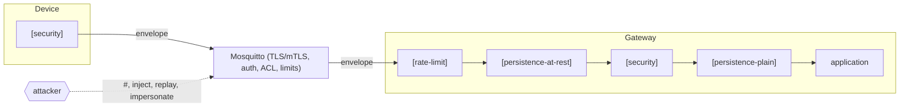

# mqtt-secure documentation

mqtt-secure is a layered security architecture for MQTT-based IoT
communication in C++23: end-to-end payload protection (AES-256-GCM or
ChaCha20-Poly1305, GMAC/Poly1305 or Ed25519 envelopes with topic binding, freshness, replay protection, downgrade
protection and key → topic binding) composed as layers in a pipeline next to
transport security (TLS/mTLS, authentication, ACLs) and a gateway rate limit —
plus a load lab that switches every defence on and off while traffic flows and
measures what each one costs and what it stops.

## Start here

| If you want to… | Read |
|---|---|
| understand the whole system in one document | **[SDD.md](SDD.md)** — Software Design Document / technical description |
| build, test and run it | [getting-started.md](getting-started.md) |
| see it on the wire (Wireshark, TLS decryption, captures for a report) | [network-analysis.md](network-analysis.md) |
| know what is protected against whom | [security/threat-model.md](security/threat-model.md) |
| implement the wire format elsewhere | [protocol/envelope-format.md](protocol/envelope-format.md) |
| add a layer, transport or crypto back-end | [extending.md](extending.md) |
| run the report's Part 2 evaluation (campaign, attacks, analysis) | [evaluation.md](evaluation.md) |

## Contents

```
docs/
├── README.md                      this index
├── SDD.md                         Software Design Document (architecture, detailed design,
│                                  interfaces, data, security, concurrency, quality, V&V,
│                                  limitations, error catalogue, traceability)
├── getting-started.md             prerequisites, build, demo, lab, first experiments, library use
├── build-system.md                CMake options, presets, flags, msec_add_module, clang-tidy, CI
├── testing.md                     unit/integration/vector/Python tests, fuzzing, sanitizers, scenarios
├── network-analysis.md            Wireshark: dissector, TLS key logging, lab captures, experiments, filters
├── benchmarks.md                  end-to-end cost matrix: zones × profiles × payload sizes, attack probes
├── evaluation.md                  report Part 2: campaign, attack matrix, analysis (S(c), cost(c), Pareto, c*)
├── extending.md                   adding layers, MQTT adapters, crypto back-ends, lab settings
├── coding-standards.md            engineering practices and conventions
├── glossary.md                    terms
├── modules/
│   ├── core.md                    Message, Topic, Result, ILayer, Pipeline, SwitchableLayer,
│   │                              SecureBuffer, clock, logger, topic filters
│   ├── mqtt.md                    IMqttClient, Endpoint, LoopbackBroker, AccessControlList, PahoClient
│   ├── security.md                SecurityLayer, envelope, ReplayGuard, key stores, KeyTopicPolicy,
│   │                              crypto interfaces, OpenSSL back-end
│   ├── data.md                    PersistenceLayer, repositories
│   └── limits.md                  RateLimitLayer
├── protocol/
│   └── envelope-format.md         wire format v2, AAD, processing order, worked example, vectors
├── security/
│   └── threat-model.md            trust boundaries, assets, adversaries, STRIDE table, residual risk
├── apps/
│   ├── gateway-demo.md            msec_gateway_demo walkthrough
│   └── load-gateway.md            msec_load_gateway: pipeline, CLI, key file, stdin protocol, JSON
└── loadgen/
    ├── overview.md                the load lab: commands, how a run works, identities
    ├── configuration.md           every setting, validation, how each change is applied, presets
    ├── components.md              each Python module
    ├── scenarios.md               the 39 attack-vs-defence experiments
    ├── dashboard-and-api.md       dashboard, HTTP API, metrics and measurement columns
    ├── dashboard-test-findings.md dashboard test run: bugs found, proposed defence ladder for demos
    └── distributed-agents.md      multi-machine runs: trust bootstrap, protocol, clock correction
```

## The system at a glance



| Module | One line |
|---|---|
| `msec::core` | shared vocabulary: messages, errors-as-values, layers and pipelines, secrets, clock, logger |
| `msec::mqtt` | transport port, endpoint, in-process broker with ACL, Paho adapter |
| `msec::security` | the payload-protection layer and everything it needs |
| `msec::data` | persistence as a layer; bounded in-memory repository |
| `msec::limits` | per-topic rate limit before crypto |

Modules depend only on `core`; applications are the only composition roots.

## Conventions in these documents

- Paths are relative to the repository root.
- "Outbound" = application → MQTT, "inbound" = MQTT → application.
- Pipelines are written application side first: `[persistence, security]`
  means persistence is closer to the application.
- Diagrams use Mermaid (rendered by GitHub and most IDEs).
