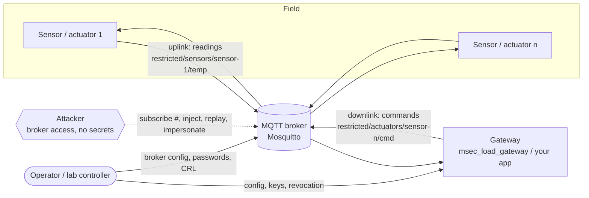
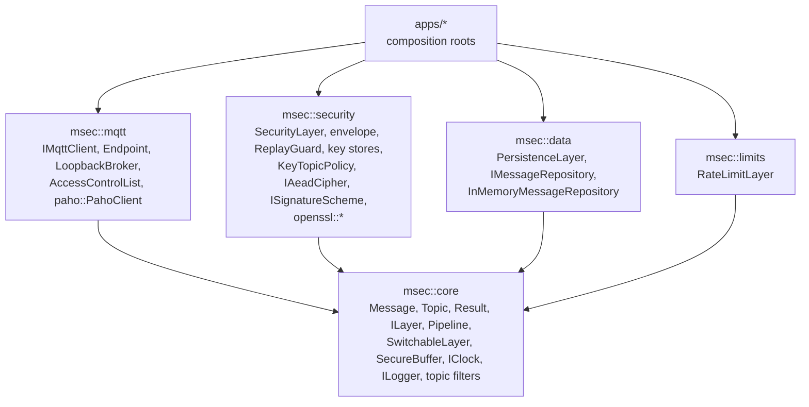
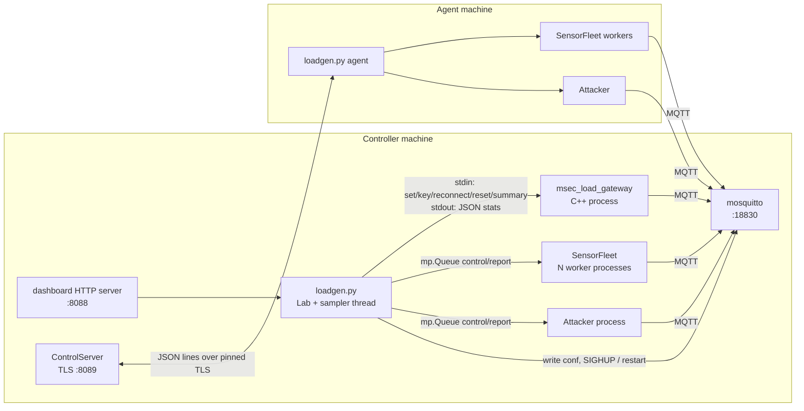

# mqtt-secure — Software Design Document

| | |
|---|---|
| **Document** | Software Design Document / Technical Description |
| **System** | mqtt-secure (`mqtt_secure` CMake project), version 0.1.0 |
| **Language / standard** | C++23 (library and gateways), Python ≥ 3.11 (load lab) |
| **Repository state described** | branch `develop`, commit `8ce0b35` ("adding hardening preset") |
| **Structure** | Loosely follows IEEE 1016 (design views) |

---

## Table of contents

1. [Introduction](#1-introduction)
2. [System overview](#2-system-overview)
3. [Design goals, constraints and assumptions](#3-design-goals-constraints-and-assumptions)
4. [Architectural design](#4-architectural-design)
5. [Detailed design](#5-detailed-design)
6. [Interface design](#6-interface-design)
7. [Data design](#7-data-design)
8. [Security design](#8-security-design)
9. [Error handling, logging and observability](#9-error-handling-logging-and-observability)
10. [Concurrency design](#10-concurrency-design)
11. [Quality attributes](#11-quality-attributes)
12. [Build, verification and validation](#12-build-verification-and-validation)
13. [Known limitations, technical debt and risks](#13-known-limitations-technical-debt-and-risks)
14. [Future work](#14-future-work)
- [Appendix A — Error code catalogue](#appendix-a--error-code-catalogue)
- [Appendix B — Threat → mechanism → evidence traceability](#appendix-b--threat--mechanism--evidence-traceability)
- [Appendix C — Source map](#appendix-c--source-map)

---

## 1. Introduction

### 1.1 Purpose

This document describes the design of **mqtt-secure**: what it is, how it is
decomposed, why each design decision was taken, how the parts interact at run
time, and how the design is verified. It is the single technical reference for
the whole repository; the per-topic documents in this folder go deeper into
individual areas (see [`README.md`](README.md)).

### 1.2 Scope

mqtt-secure is a **layered security architecture for MQTT-based IoT
communication**. The repository contains:

| Deliverable | Location | Kind |
|---|---|---|
| Five C++23 libraries: `msec::core`, `msec::mqtt`, `msec::security`, `msec::data`, `msec::limits` | `modules/` | static libraries |
| A self-contained demo gateway over an in-process broker | `apps/gateway` | executable `msec_gateway_demo` |
| A load-test gateway over a real Mosquitto broker, every feature switchable at run time | `apps/load_gateway` | executable `msec_load_gateway` |
| Unit, integration, cross-language and fuzz tests | `tests/`, `fuzz/` | GoogleTest, libFuzzer |
| End-to-end CPU-cost benchmarks per security level | `benchmarks/` | Google Benchmark |
| The **load lab**: a Python harness that runs Mosquitto, the load gateway, simulated sensors/actuators and an attacker, with a live dashboard, measurement matrices, PASS/FAIL attack scenarios and multi-machine agents | `tools/loadgen/` | Python |
| Wireshark tooling: envelope dissector, TLS key-log shim for mosquitto and the gateway, lab packet capture with embedded secrets and event annotations | `tools/wireshark/`, `tools/loadgen/{capture,keylog,pcapgen}.py` | Lua, C++, Python |
| Build system, presets, CI | `CMakeLists.txt`, `cmake/`, `CMakePresets.json`, `.github/` | CMake, GitHub Actions |

Out of scope: a production key-provisioning service, persistent storage
back-ends, a hardened MQTT broker of its own (Mosquitto is used), and
deployment packaging.

### 1.3 Intended audience

- Engineers extending or integrating the libraries (sections 4–7, 10).
- Security reviewers and report authors (sections 8, 13, Appendix B).
- Anyone running experiments with the load lab (sections 4.6, 5.8, 6.4–6.7).

### 1.4 Conventions

- `code` names refer to identifiers in the source; `path:line` references are
  relative to the repository root.
- "Outbound" means application → transport (publish). "Inbound" means
  transport → application (receive).
- "Gateway" is the trusted back-end that receives sensor data and sends
  actuator commands. "Sensor"/"device" is an IoT node; in the lab every sensor
  is also an actuator.
- MUST / MUST NOT are used for invariants the code relies on.

### 1.5 References

| Ref | Document |
|---|---|
| MQTT311 | OASIS MQTT Version 3.1.1 (topic rules §1.5.3, §4.7) |
| MQTT5 | OASIS MQTT Version 5.0 |
| RFC 4303 | IP Encapsulating Security Payload — §3.4.3 anti-replay window |
| RFC 8032 | Edwards-Curve Digital Signature Algorithm (Ed25519) |
| NIST SP 800-38D | GCM / GMAC |
| Mosquitto 2.0 | `mosquitto.conf(5)`, `acl_file` semantics |

---

## 2. System overview

### 2.1 Problem statement

MQTT is a publish/subscribe protocol in which **every message passes through a
broker**. Transport security (TLS) protects the hop between a client and the
broker, but terminates *at* the broker: the broker, any client allowed to
subscribe to a topic, and anybody who compromises either can read, replay or
inject messages. IoT deployments additionally face constrained devices,
long-lived keys, compromised individual devices and message floods.

### 2.2 Solution summary

mqtt-secure applies **defence in depth** with independently switchable layers:

```
                ┌──────────── Layer 1: transport (broker) ───────────┐
 sensor ──TLS/mTLS──▶ Mosquitto (auth, ACL, client-id binding, limits) ──TLS──▶ gateway
   │                                                                              │
   └────────── Layer 2: payload, end to end (SecurityLayer envelope) ─────────────┘
                                                         Layer 3: gateway rate limit
```

1. **Transport** (broker side): TLS 1.2/1.3, mutual TLS with certificate CN as
   username, password authentication, topic ACLs, client-id binding, packet and
   connection limits.
2. **Payload** (`msec::security::SecurityLayer`): every payload is wrapped in an
   authenticated *envelope*: AES-256-GCM encryption, GMAC-only authentication,
   or Ed25519 signatures; the MQTT topic and the header are bound into the
   authenticated data; freshness window, RFC 4303 replay window, receiver-side
   mode policy (no downgrade), and key → topic binding.
3. **Gateway limits** (`msec::limits::RateLimitLayer`): per-topic token bucket
   that drops floods *before* any cryptography.

These are composed as **layers in an ordered pipeline** between the application
and the MQTT transport. Each layer can transform, observe or reject a message.

### 2.3 Key capabilities

- Payload protection that survives an **untrusted broker**.
- **Proof of origin** with signatures: the gateway can verify but not forge
  device data.
- **Every feature switchable while traffic flows** (`SwitchableLayer`, atomic
  runtime switches), which enables live A/B experiments.
- Key **rotation** (epochs) and **revocation** (keys, passwords, certificates/CRL).
- Byte-for-byte **interoperable C++ and Python** envelope implementations,
  pinned by shared test vectors.
- A measurement apparatus that reports both **what each defence costs** (CPU,
  latency, bytes) and **what it buys** (which attacks still succeed).

---

## 3. Design goals, constraints and assumptions

### 3.1 Goals

| ID | Goal |
|---|---|
| G1 | Protect confidentiality, integrity, authenticity and freshness of MQTT payloads **end to end**, independent of the broker. |
| G2 | Make each protection **independently selectable** so its cost and benefit can be measured in isolation. |
| G3 | Keep modules **decoupled**: transport, security, storage and limits know only `core`. |
| G4 | Be **safe by construction**: invalid states unrepresentable, errors as values, bounded memory wherever attacker input creates state. |
| G5 | Be **deterministic under test**: all external effects (clock, RNG, transport, storage) injected. |
| G6 | Provide **evidence**: automated tests, fuzzing, benchmarks and attack scenarios with predicted outcomes. |

### 3.2 Constraints

| Constraint | Consequence |
|---|---|
| C++23, GCC ≥ 13 or Clang ≥ 17 | `std::expected`, `std::format`, ranges, designated initialisers are used throughout. |
| OpenSSL ≥ 3.0 | Only crypto back-end (`MSEC_WITH_OPENSSL`). |
| Eclipse Paho MQTT C++ | Only real-network MQTT adapter (`MSEC_WITH_PAHO`). |
| CMake ≥ 3.25, Ninja | Presets file version 6. |
| Mosquitto 2.0.x | Load lab broker; its reload-vs-restart behaviour shaped `broker.py`. |
| No exceptions across module boundaries | Third-party exceptions (Paho) are caught at the adapter. |

### 3.3 Assumptions

- **A1** Keys are provisioned out of band (pre-shared). The lab simulates
  provisioning over a pinned TLS control channel.
- **A2** One key id identifies exactly one sender (needed for replay windows and
  key → topic binding).
- **A3** Sender and receiver clocks agree within `max_clock_skew` (5 s) and
  messages arrive within `max_message_age` (60 s) when freshness is on.
- **A4** The gateway is trusted with the AEAD keys of all devices; with `sign`
  it holds only public keys of devices.
- **A5** The underlying OpenSSL and CSPRNG are correct.

---

## 4. Architectural design

### 4.1 Context view



| Actor | Trust | Holds |
|---|---|---|
| Sensor/actuator | trusted until compromised | its own AEAD key + Ed25519 private key; gateway's AEAD (downlink group) key and public key; its password and client certificate |
| Broker | **not trusted** for payload confidentiality/integrity | TLS server key, password file, ACL, CRL |
| Gateway | trusted | every device's AEAD key and public key; only its own private key |
| Attacker | untrusted | broker address and public CA certificate only |

### 4.2 Logical decomposition and dependency rule



**Rule:** a module depends **only on `core`**, never on a sibling. `mqtt` does
not know that payload security exists; `security` does not know about MQTT
clients. They meet through `ILayer` and `Message`. Only composition roots
(`apps/*/main.cpp`, tests, benchmarks) know concrete classes. This is enforced
by the CMake link graph: each module's `PUBLIC_DEPS` is `msec::core` only.

Generic MQTT topic logic (`validate_topic_filter`, `topic_matches`) lives in
`core` precisely so that `security` (key → topic policy) can use it without
depending on `mqtt`; `msec/mqtt/topic_filter.hpp` merely re-exports it.

### 4.3 Pipeline architecture

The central abstraction is the **layer pipeline** (`msec::Pipeline`):

```
application ──outbound──▶ L0 ▶ L1 ▶ … ▶ Ln ──▶ MQTT
application ◀──inbound─── L0 ◀ L1 ◀ … ◀ Ln ◀── MQTT
```

- Layers are ordered from the **application side (first)** to the **transport
  side (last)**. Outbound traverses them forwards; inbound in reverse.
- Each layer returns `Result<Message>`. The first error **stops processing**;
  the pipeline prefixes the error message with `[layer-name]`.
- The pipeline is **immutable** once built (no locks at pipeline level). Runtime
  variability is achieved by building every layer in up front and wrapping it
  in a `SwitchableLayer` (pass-through when disabled, one atomic flag).
- **Order carries meaning.** `[persistence, security]` stores plaintext;
  `[security, persistence]` stores envelopes (encryption at rest).
  `RateLimitLayer` belongs on the transport side so floods are dropped before
  crypto.

The canonical pipelines in this repository:

| Where | Pipeline (app side → transport side) |
|---|---|
| Demo sensor (`apps/gateway`) | `[security]` |
| Demo gateway (`apps/gateway`) | `[persistence, security]` |
| Load gateway (`apps/load_gateway`) | `[persistence-plain⁎, security⁎, persistence-at-rest⁎, rate-limit]` (⁎ = `SwitchableLayer`) |
| Integration test gateway | `[persistence, security]` |
| Benchmarks (gateway) | `[persistence?, security?, persistence?]` per profile |

### 4.4 Component summary

| Module | Component | Role |
|---|---|---|
| core | `Topic`, `Message`, `QoS` | validated value types flowing through the pipeline |
| core | `Error`, `ErrorCode`, `Result<T>`, `Status` | errors as values |
| core | `ILayer`, `Pipeline`, `Pipeline::Builder` | processing chain |
| core | `SwitchableLayer` | runtime on/off decorator |
| core | `SecureBuffer`, `secure_zero` | secret storage, wiping |
| core | `IClock`/`SystemClock`, `ILogger`/`ConsoleLogger`/`NullLogger` | injected effects |
| core | `validate_topic_filter`, `topic_matches` | MQTT §4.7 filter logic |
| mqtt | `IMqttClient` | transport port |
| mqtt | `Endpoint` | binds a client to a pipeline; counts and reports rejections |
| mqtt | `LoopbackBroker`/`LoopbackClient` | in-process synchronous broker for tests/demo/benchmarks |
| mqtt | `AccessControlList` | Mosquitto-style deny-by-default topic ACL for the loopback broker |
| mqtt | `paho::PahoClient` | real MQTT over TCP/TLS via Eclipse Paho C++ |
| security | `SecurityLayer` | the payload-protection layer |
| security | `envelope::{serialize,parse,associated_data}` | wire format v2 |
| security | `ReplayGuard` | RFC 4303 sliding window, bounded |
| security | `IKeyStore`/`InMemoryKeyStore` | key lookup, revocation |
| security | `IKeyAuthorization`/`KeyTopicPolicy` | key → topic binding |
| security | `IAeadCipher`/`openssl::AesGcmCipher` | AES-256-GCM |
| security | `ISignatureScheme`/`openssl::Ed25519Signer` | Ed25519 |
| security | `IRandomSource`/`openssl::RandomSource` | CSPRNG |
| data | `PersistenceLayer` | records messages passing through |
| data | `IMessageRepository`/`InMemoryMessageRepository` | bounded ring buffer storage |
| limits | `RateLimitLayer` | per-topic inbound token bucket |

Detailed API references: [`modules/`](modules/).

### 4.5 Process view (load lab)



Process boundaries are deliberate: the gateway is the real C++ system under
test, Python only drives it; sensors run in `spawn`ed worker processes to scale
past the GIL; the attacker is isolated so its state cannot leak into the
legitimate fleet.

### 4.6 Deployment views

**(a) Demo / tests / benchmarks** — single process, `LoopbackBroker`, no
network. Deterministic; measures pure CPU cost of layers.

**(b) Load lab, single machine** — `./run.sh` or `loadgen.py live`: a private
Mosquitto on port 18830 (system broker untouched), one gateway, N sensors
across `load.processes` workers, one attacker, dashboard on
`127.0.0.1:8088`.

**(c) Load lab, distributed** — controller runs broker + gateway + dashboard +
control server (`:8089`); agent machines run sensor slices and/or attackers.
Sensors on agents generate their private keys locally and enrol via CSR.

| Port | Service | Bound to |
|---|---|---|
| 18830 | Mosquitto (only the active transport's listener exists) | `broker.host` |
| 8088 | Dashboard / HTTP API (no authentication) | `127.0.0.1` by default |
| 8089 | Agent control plane (TLS, token, pinned cert) | `cluster.listen` |

### 4.7 Design rationale (selected decisions)

| Decision | Alternatives | Rationale |
|---|---|---|
| Payload security as a pipeline layer | inside the MQTT adapter; in the app | keeps transport ignorant of security (G3); same layer serves both directions and any transport |
| Immutable pipeline + `SwitchableLayer` | mutable pipeline with locks | no locking on the hot path; switching is one relaxed atomic store; a message in flight finishes with the setting it started with |
| Mode in the envelope header + receiver acceptance set | mode configured out of band | lets mixed fleets coexist while preventing downgrade (mode is authenticated via AAD and must be in `accept`) |
| Topic in the AAD | topic in the plaintext | binds a ciphertext to its topic without growing the wire format |
| Freshness checked **before** crypto, replay **after** | all after | cheap rejection of stale traffic; replay state must only move on authenticated input |
| Key binding checked **after** authentication | before | unauthenticated input must not be able to probe the policy |
| Uniform `AuthenticationFailed` | distinct codes per cause | avoids a verification oracle |
| Random 96-bit GCM nonces | counter nonces | stateless across restarts; safe to ~2³² messages per key (rotate) |
| Ed25519 option | ECDSA | deterministic, fast, small keys/signatures, no nonce pitfalls |
| Bounded `ReplayGuard`, rate-limit buckets, repository | unbounded maps | attacker-created state must not exhaust memory (G4) |
| `std::expected` errors | exceptions | explicit, `[[nodiscard]]`, no unwinding across module/C boundaries |
| Factories (`create`) + `PassKey` constructors | public constructors | dependency validation cannot be bypassed while `make_unique` still works |

---

## 5. Detailed design

### 5.1 core

**`Topic`** — a validated MQTT *topic name*. Only obtainable via
`Topic::create`, which rejects: empty, longer than 65 535 bytes, containing
NUL, or containing `+`/`#`. UTF-8 well-formedness is not yet checked
(`TODO(validation)` in `modules/core/src/message.cpp`). Totally ordered
(`operator<=>`).

**`Message`** — `{Topic topic; Bytes payload; QoS qos = AtLeastOnce; bool
retain; bool duplicate}`. `retain`/`duplicate` are informational on inbound.

**`Error` / `Result<T>` / `Status`** — `Error{ErrorCode code; std::string
message}`; `Result<T> = std::expected<T, Error>`; `Status = Result<void>`;
`make_error(code, msg)` builds an `unexpected`. `to_string(ErrorCode)` is
`constexpr`.

**`ILayer`** — `name()`, `on_outbound(Message)`, `on_inbound(Message)`; all
`[[nodiscard]]`. Contract: thread-safe (both directions may run concurrently),
never throws, deterministic given injected dependencies. Non-copyable,
non-movable (prevents slicing).

**`Pipeline`** — built by `Pipeline::Builder::add(...).build()`. `build()` fails
with `InvalidArgument` if a null layer was added or two layers share a name
(names are used to annotate errors and must be unambiguous). Move-only.
`process_outbound` iterates forwards; `process_inbound` iterates
`std::views::reverse`. `layer_names()` returns the order.

**`SwitchableLayer`** — decorator: `create(inner, enabled = true, name = {})`;
empty `name` → inner's name. `set_enabled`/`enabled` use
`memory_order_relaxed` (no data is published through the flag; the inner layer
is always fully constructed). `inner()` exposes the wrapped layer.

**`SecureBuffer`** — owning, non-copyable byte buffer for secrets; fixed size
after construction (no reallocation leaving stale copies); zeroed on
destruction and before move-assignment; moved-from buffers are cleared.
`secure_zero` writes through a `volatile` pointer followed by
`atomic_signal_fence` so the stores cannot be elided.

**`IClock` / `SystemClock`** — `now()` returning `system_clock::time_point`.
Tests use `test::FakeClock` with `advance()`.

**`ILogger`** — `log(level, component, message) noexcept`. `ConsoleLogger`
formats `HH:MM:SS.mmm LEVEL [component] message`, writes `Warn`/`Error` to
stderr and the rest to stdout under a mutex, and swallows any exception.
`NullLogger` discards. Policy: never log secrets or plaintext payloads.

**Topic filters** — `validate_topic_filter`: non-empty, ≤ 65 535, no NUL, `+`
must be an entire level, `#` must be the entire last level.
`topic_matches(filter, topic)`: level-wise; `+` matches one level; `#` matches
the rest *including the parent* (`a/#` matches `a`); a leading wildcard never
matches a topic starting with `$` (MQTT §4.7.2).

### 5.2 mqtt

**`IMqttClient`** — `connect(ConnectionOptions)`, `disconnect()`,
`is_connected()`, `publish(Message)`, `subscribe(filter, qos)`,
`unsubscribe(filter)`, `set_message_handler(MessageHandler)`. The handler may
run on a library-owned thread.

**`ConnectionOptions`** — `broker_uri` (`tcp://`/`ssl://`), `client_id`,
optional `TlsOptions{ca_file, client_cert_file, client_key_file, verify_peer =
true}`, optional `username`, optional `SecureBuffer password`, `keep_alive`
(30 s), `clean_session` (true; MQTT 5 clean start), `protocol` (`V311`=4 /
`V5`=5).

**`Endpoint`** — the composition point of one client and one pipeline.

```
publish(m):  pipeline.process_outbound(m) ─▶ client.publish ─▶ ++published
             └─ error ─▶ ++rejected_outbound, log Error, return error
incoming(m): remember {topic, retain, duplicate}
             pipeline.process_inbound(m) ─▶ app handler ─▶ ++delivered
             └─ error ─▶ ++rejected_inbound, log Warn, rejection handler(info, error)
```

Handlers are copied out under `handler_mutex_` and invoked outside it, so a
handler may call back into the endpoint. The destructor detaches the client's
handler *before* members die and disconnects if connected. `stats()` returns
relaxed-atomic counters `{published, delivered, rejected_inbound,
rejected_outbound}`. Rejected payloads are not exposed (the pipeline consumed
them); `Rejected` carries only topic and flags.

**`LoopbackBroker` / `LoopbackClient`** — in-process, synchronous, lossless.
`route(message, publisher_id)`: if an ACL exists and the publisher lacks Write
→ `PermissionDenied`; otherwise, under the lock, collect each distinct live
subscriber whose filter matches and (if ACL) who may Read the topic; then
deliver **outside the lock** so handlers can publish re-entrantly.
Subscriptions hold `weak_ptr` clients plus a raw identity pointer for removal;
the client removes itself on destruction. QoS is ignored. Client id is stored
as `atomic<shared_ptr<const string>>`.

**`AccessControlList`** — rules `{any_client, client_id, filter, access}`;
`allow(client, filter, access)` (client id required), `allow_all(filter,
access)`; filters validated. `can_publish` needs `Write`, `can_read` needs
`Read`; deny by default; any matching rule grants. Rules are keyed by client
id, which is only a *claim* unless the broker authenticates.

**`paho::PahoClient`** — adapter over `mqtt::async_client`.
- `connect()` serialises lifecycle under `client_mutex_`, closes any existing
  client first (so it can switch broker/transport/credentials at any time),
  maps protocol version, clean session/start, keep-alive, timeout, credentials
  (password passed as binary from the `SecureBuffer`) and TLS
  (`enable_server_cert_auth`/`verify` = `verify_peer`, trust store, key store,
  private key).
- Every operation blocks on its token up to `timeout` (default 10 s).
- `subscribe()` maps a SUBACK reason code ≥ 0x80 to `PermissionDenied`.
- Incoming messages with an invalid topic name are dropped.
- Paho exceptions are converted to `ConnectionFailed`.
- **Paho 1.2 token lifetime workaround:** the last waited-on token is parked in
  `last_token_` until the next Paho call (which takes Paho's global mutex and
  therefore cannot return before the previous callback has finished), and is
  released only after the client is destroyed. Dropping it right after
  `wait_for()` was a use-after-free race.

### 5.3 security

#### 5.3.1 Types

- `KeyId = uint32_t` (by convention one sender per key).
- `PayloadProtection { Encrypt = 1, AuthenticateOnly = 2, Sign = 3 }`; wire
  value = enum value; `protection_from_wire` rejects anything else.
- `ProtectionSet` — `constexpr` bitset (`bit = 1 << mode`), stored atomically in
  the layer as `uint8_t`.

#### 5.3.2 Envelope

See [section 6.1](#61-envelope-wire-format-v2) for the format.
`serialize` writes magic, version, mode, key id, sequence, timestamp
(`bit_cast` to unsigned), nonce length (rejects > 32), nonce, body. `parse`
validates: length ≥ 25, magic `MS`, version 2, known mode, sequence ≠ 0,
nonce length ≤ 32, **non-empty body**. `associated_data(header, nonce,
topic)` = header ‖ nonce ‖ u16(topic length) ‖ topic. A fuzz target asserts
`serialize(parse(x)) == x` for every accepted `x`.

#### 5.3.3 `SecurityLayer`

Construction (`create(config, deps)`) fails if `cipher`, `key_store`, `random`
or `clock` is missing; if the cipher nonce size is 0 or > 32; if
`max_message_age ≤ 0` or `max_clock_skew < 0`; if the sending mode needs
missing dependencies (Sign needs `signer` + `signing_keys`); or if the accept
set is empty or includes Sign without `signer` + `verify_keys`. `accept`
defaults to `{protection}`.

Runtime state (all atomics, relaxed): `protection_`, `accept_`,
`enforce_freshness_`, `enforce_replay_protection_`, `enforce_key_binding_`,
`sending_key_id_`, `next_sequence_` (starts at 1). `config()` returns the
static config overlaid with the current switches.

**Outbound algorithm**

```
mode   ← protection_
store  ← (mode == Sign) ? signing_keys : key_store         (InvalidState if absent)
key    ← store.find(sending_key_id_)                         (NotFound)
check key size == signer.private_key_size | cipher.key_size  (CryptoFailure)
seq    ← next_sequence_++                                    (0 ⇒ wrapped ⇒ InvalidState "rotate key")
nonce  ← Sign ? ∅ : random(cipher.nonce_size)
header ← {v2, mode, key id, seq, now_ms}
aad    ← header ‖ nonce ‖ u16 |topic| ‖ topic
body   ← Encrypt:  AEAD.seal(key, nonce, payload, aad)                = ct ‖ tag
         AuthOnly: payload ‖ AEAD.seal(key, nonce, ∅, aad ‖ payload)  = payload ‖ tag
         Sign:     payload ‖ Ed25519.sign(key, aad ‖ payload)         = payload ‖ sig
wire   ← serialize(header, nonce, body)
secure_zero(original payload); message.payload ← wire
```

**Inbound algorithm** (ordered cheapest-first, with the security-relevant
ordering constraints noted)

| # | Step | Failure |
|---|---|---|
| 1 | `envelope::parse` | `MalformedMessage` |
| 2 | mode ∈ `accept_` (mode not yet authenticated, but it is in the AAD, so forging it can only make verification fail) | `ProtectionNotAccepted` |
| 3 | nonce length == (Sign ? 0 : cipher nonce size) | `MalformedMessage` |
| 4 | if freshness: `now − max_age ≤ ts ≤ now + max_skew` (bounds computed from `now`, never from the untrusted timestamp, to avoid signed overflow) | `MessageExpired` |
| 5 | key lookup in `verify_keys` (Sign) or `key_store` | `AuthenticationFailed` ("unknown key id") |
| 6 | rebuild AAD with the **received** topic; verify/decrypt | `AuthenticationFailed` (uniform: no oracle) |
| 7 | if authorization present and binding on: `may_publish(key, topic)` — after auth so unauthenticated input cannot probe policy | `PermissionDenied` (plaintext wiped) |
| 8 | if replay on: `ReplayGuard::check_and_record` — after auth so forged sequence numbers cannot advance the window; after binding so a rejected message does not consume its sequence number | `ReplayDetected` / `CapacityExceeded` (plaintext wiped) |
| 9 | payload ← plaintext | — |

Other operations: `set_protection(mode)` (validates, sets sending mode **and**
narrows accept to `{mode}`), `set_accepted(set)`, the three `set_enforce_*`
switches, `set_sending_key(id)` (rotation), `forget_key(id)` (drop replay
window after revocation; ids MUST NOT be reused afterwards).

#### 5.3.4 `ReplayGuard`

Per key: `{highest, bitmap}` where bit *i* means `highest − i` was seen;
window `kWindowSize = 64`.

```
seq == 0               → InvalidArgument
unknown key:  if |windows| ≥ max_tracked_keys → CapacityExceeded
              else window = {seq, 1}
seq > highest: shift = seq − highest
               bitmap = shift ≥ 64 ? 1 : (bitmap << shift) | 1; highest = seq
offset = highest − seq ≥ 64      → ReplayDetected ("outside window")
bitmap bit(offset) set           → ReplayDetected ("duplicate")
else set bit
```

`forget(key)` frees a slot. Mutex-protected. Default capacity 1024 senders
(`SecurityConfig::max_tracked_senders`; the load gateway raises it to the
number of keys loaded).

#### 5.3.5 Key stores and policy

`InMemoryKeyStore` — `add` rejects empty keys and **refuses to overwrite** an
existing id (rotation must be explicit revoke + add); `revoke` returns
`NotFound` if absent; `find` returns `shared_ptr<const SecureBuffer>` so an
in-flight operation keeps a revoked key alive safely. Mutex-protected.

`KeyTopicPolicy` (`IKeyAuthorization`) — deny by default.
- `allow_pattern(filter)`: rule for every key with `%k` → key id and `%u` →
  owner substituted (validated with placeholders `0`/`x`).
- `allow(key, filter)`: explicit per-key rule.
- `set_owner(key, owner)`: owner must be one plain level (no `/ + # $`, NUL,
  non-empty) so substitution cannot widen a match.
- `remove(key)`: drops owner and per-key rules.
- `may_publish`: explicit rules first; then patterns, skipping `%u` patterns for
  keys without an owner (never substitutes an empty level).
- `shared_mutex`: concurrent readers, exclusive writers.

#### 5.3.6 OpenSSL back-end

`AesGcmCipher` — EVP AES-256-GCM, 32-byte key, 12-byte nonce, 16-byte tag;
validates sizes and `int` limits; on decryption failure or tag mismatch the
output buffer is `secure_zero`ed (never release unauthenticated plaintext).
`Ed25519Signer` — raw 32-byte keys, 64-byte deterministic signatures via
`EVP_DigestSign/Verify`; `public_key()` derives the public key.
`RandomSource` — `RAND_bytes`.

### 5.4 data

`PersistenceLayer` — pass-through that records messages via
`IMessageRepository::store(message, direction, clock.now())`.
`PersistenceConfig{store_inbound = true, store_outbound = false,
fail_on_storage_error = false}`: storage errors are swallowed unless
`fail_on_storage_error` (audit-critical) in which case the message is rejected.
Its **position** decides plaintext vs at-rest storage.

`InMemoryMessageRepository(capacity)` — mutex-protected `deque` ring buffer;
evicts the oldest when full; ids monotonically increase from 1; `store` fails
with `CapacityExceeded` if capacity is 0; `find_by_topic` and `latest` return
newest-first, at most `limit`.

### 5.5 limits

`RateLimitLayer` — inbound-only per-topic token bucket; outbound passes.
`RateLimitConfig{messages_per_second = 0 (off), burst = 0 (→ one second's
worth, min 1), max_tracked_topics = 4096}`.

```
rate ← rate_ (atomic); rate ≤ 0 → pass
burst ← max(config.burst > 0 ? config.burst : rate, 1)
lock
bucket ← buckets[topic] or, if new:
          if full: evict buckets that would already be full again (idle)
          if room: insert {tokens = burst, last = now}
          else: use the shared overflow bucket
refill: tokens = min(burst, tokens + max(now − last, 0)·rate); last = max(last, now)
tokens < 1 → RateLimited; else tokens −= 1
```

Clock steps backwards neither mint nor destroy tokens. Topic floods cannot
mint budget because untracked topics share one overflow bucket. `set_rate`
clamps negatives/non-finite to 0 and keeps existing buckets.

### 5.6 `msec_gateway_demo` (apps/gateway)

A deterministic narrative of the architecture over a `LoopbackBroker` with a
two-zone ACL (`open/#` for all; `restricted/sensors/room1/#` writable only by
`sensor-1`; `restricted/sensors/#` readable only by `gateway`):

1. Sensor publishes three restricted and two open messages (encrypted).
2. Attacker `mallory` subscribed to `#` captures only the 2 open envelopes.
3. Attacks: replay (gateway rejects, `ReplayDetected`), tamper (rejects,
   `AuthenticationFailed`), rebind into restricted (broker denies), inject
   restricted (broker denies), inject plaintext into open (gateway rejects,
   `MalformedMessage`).
4. Exit code 0 iff captured = 2, delivered = 5, rejected = 3, ACL-denied = 2.

Details: [`apps/gateway-demo.md`](apps/gateway-demo.md).

### 5.7 `msec_load_gateway` (apps/load_gateway)

The system under test for the load lab: a gateway over `PahoClient` whose
every feature is a setting changeable while traffic flows.

- **Pipeline** (built once): `persistence-plain⁎ → security⁎ →
  persistence-at-rest⁎ → rate-limit`. `apply_pipeline()` pushes settings into
  the live layers (switches, `set_protection`, `set_enforce_*`,
  `set_sending_key`, `set_rate`).
- **`KeyRing`**: three `InMemoryKeyStore`s (`aead`, `sign_private`,
  `sign_public`) and a `KeyTopicPolicy`; loads a key file
  (`<id> <kind> <hex> [owner]`); `key add` / `key revoke` at run time (revoke
  removes the id from all stores, the policy, the replay window and the owner
  map). `devices()` = owners other than `gateway` (downlink targets).
- **`Stats`**: fed from Paho's callback thread; counts delivered, rejected
  (by `ErrorCode`), bytes, retained, QoS duplicates rejected, commands
  sent/failed; detects **forgeries the gateway accepted** (`"FORGED!!"` at
  plaintext offset 8) and **replays accepted** (send-time ⊕ hash(topic) seen
  before, 2¹⁸-entry FIFO set); latency = gateway `now` − sensor send-time
  (first 8 plaintext bytes, ns since epoch).
- **Downlink**: at `--downlink N` commands/s, round-robin over devices, through
  the outbound pipeline, to `<zone>/actuators/<owner>/cmd`; plaintext =
  u64 send time ‖ u64 command id ‖ `"CMD:<owner>"`; never bursts more than one
  second's worth after a pause.
- **Control**: `--control stdin` commands (`set`, `key add|revoke`,
  `reconnect`, `reset`, `summary`, `quit`) read by a detached thread into a
  queue drained by the 20 ms main loop. Transport keys need `reconnect`;
  pipeline keys apply immediately. EOF on stdin ⇒ `quit`.
- **Self-healing**: if disconnected, reconnect at most once per second with the
  current settings (the broker drops the gateway when credentials/ACLs/TLS
  change).
- **Output**: `READY {settings}` on stderr when started; per `--report` a stats
  line (JSON on stdout or text on stderr); a summary JSON on exit or on
  `summary`.

Full CLI, protocol and schemas: [`apps/load-gateway.md`](apps/load-gateway.md).

### 5.8 Load lab (tools/loadgen)

| Module | Responsibility |
|---|---|
| `loadgen.py` | CLI: `live`, `matrix`, `scenarios`, `attacks`, `campaign`, `agent`; config layering defaults < `--config` TOML < `--preset` < `--set` |
| `lab.py` | `Lab`: config schema (`DEFAULTS`, `SPEC`, `STARTUP_ONLY`), validation (`validate`, `merged`), `hardened` preset, start/stop of every part, `apply(patch)` performing the minimal action per change, key rotation (epochs, 3 s grace), revocation, 1 Hz metrics sampler, `measure()` windows |
| `broker.py` | `Broker`: writes `mosquitto.conf` + ACL, starts/stops Mosquitto, `apply()` = reload (`SIGHUP`) or restart as measured for Mosquitto 2.0.18; CPU from `/proc` |
| `gateway.py` | `GatewayProcess`: spawns `msec_load_gateway` with stdin control, parses JSON stats/summary |
| `sensors.py` | `SensorFleet`: N sensors over `spawn`ed worker processes with hand-driven paho sockets; each sensor publishes on schedule (round robin), seals with `Protector`, and as actuator verifies commands with `Verifier`; reports every 0.5 s |
| `attacker.py` | `Attacker`: separate process; subscribes `#`, optionally impersonates `gateway`, injects forged plaintext, replays captured messages |
| `pki.py` | CA (ECDSA P-256), server/client certificates, CSRs, CRLs, passwords (`mosquitto_passwd`), payload key sets and per-role *views* |
| `msec_envelope.py` | Python `Protector`/`Verifier` byte-compatible with the C++ envelope; `KeySet` and key-file format |
| `cluster.py` | `ControlServer` (TLS, token, agent registry, `claim`), `ControllerIdentity` (persistent CA/cert/token), `RemoteSensors`/`RemoteAttacker`, `FleetGroup`/`AttackerGroup` |
| `agent.py` | agent main loop: pinned-fingerprint TLS, hello/token, CSR enrolment, provisioning into a 0700 temp dir, NTP-style clock offset estimation |
| `scenarios.py` | 39 named attack-vs-defence experiments with PASS/FAIL predicates (each attack of the report with a negative control) |
| `attacks.py` | the report's attack set 𝒜 against every level K0–K11: π_a(c), the input of S(c) |
| `relay.py` | the on-path attacker: a TCP relay on the gateway's link that counts readable readings and, on plain MQTT, alters, redirects, delays or drops messages |
| `campaign.py`, `manifest.py` | the report's measurement procedure: repetitions in a seeded random order, raw data per run, manifest (code, platform, software, thermal state), frozen analysis parameters |
| `procstats.py` | peak RSS of gateway and broker, bytes on the gateway's socket (`ss`), octets per message split by layer |
| `tools/analysis/` | `analyze.py` (bootstrap CIs, marginal cost, S(c), cost(c), Pareto, c*, Δa/Δs calibration, tables and figures) and `microbench.py` (level 1); see [evaluation.md](evaluation.md) |
| `dashboard.py` / `.html` | stdlib HTTP server + single-page dashboard (canvas charts, controls, event markers) |
| `keylog.py` | `SSLKEYLOGFILE` handling: Python TLS contexts log their secrets; `LD_PRELOAD` environment for mosquitto and the gateway |
| `capture.py` | `--capture`: dumpcap recording, then editcap embeds TLS secrets and a packet comment per lab event |
| `pcapgen.py` | synthetic captures (sample traffic, recorded real TLS sessions) for the dissector and its tests |

**Applying a change** (`Lab.apply`): validate → compute changed keys → reject
startup-only, decreasing `key_epoch`, shrinking `revoked` → then:

| Changed | Action |
|---|---|
| `response.revoked` | revoke keys at gateway, rewrite passwd (without revoked users) and CRL |
| any broker key / revoked | `Broker.apply` → reload or restart; on restart or mode change: gateway `set transport` + `reconnect`; on mode change: fleet and attacker get the new transport |
| `transport.protocol` | gateway `set protocol` + `reconnect`; fleet and attacker reconnect |
| `payload.protection` / `freshness` / `replay` | gateway `set`; fleet `update` |
| `payload.key_binding` / `rate_limit`, `storage.persistence`, `downlink.rate` | gateway `set` |
| `payload.key_epoch` | rotation (below) |
| `load.*` (live) | fleet `update`; `zone` also to attacker and gateway |
| `attacker.*` | attacker `update` |

**Key rotation** (`key_epoch` e → e′): `make_keys(active sensors, e′)` (key id =
e′·10⁶ + device) → gateway `key add` (gateway view) → fleet `add_keys` (each
member only its own sensors' device view) → fleet `epoch` (sensors rekey) →
gateway `set sending_key` → after 3 s: gateway `key revoke` every old id, fleet
`drop_keys`.

**Revocation** (`revoked` grows): keys of those sensors leave the gateway; the
broker password file is rewritten without them (reload drops them if auth is
on); their certificates go on the CRL (with mtls: broker restart so live
sessions end). Permanent for the run.

Details: [`loadgen/`](loadgen/).

---

## 6. Interface design

### 6.1 Envelope wire format v2

All integers big-endian.

| Offset | Size | Field | Notes |
|---|---|---|---|
| 0 | 2 | magic | `"MS"` (0x4D 0x53) |
| 2 | 1 | version | 2 |
| 3 | 1 | mode | 1 encrypt, 2 auth_only, 3 sign |
| 4 | 4 | key id | |
| 8 | 8 | sequence | ≥ 1, monotonic per sender |
| 16 | 8 | timestamp | ms since Unix epoch, signed |
| 24 | 1 | nonce length N | 12 for AES-GCM, 0 for sign, ≤ 32 |
| 25 | N | nonce | |
| 25+N | … | body | encrypt: ciphertext ‖ tag(16) · auth_only: payload ‖ tag(16) · sign: payload ‖ signature(64) |

AAD = bytes `[0, 25+N)` ‖ u16(topic length) ‖ topic bytes.

Overhead per message: **53 B** (encrypt, auth_only), **89 B** (sign).

Full specification with a worked byte-level example:
[`protocol/envelope-format.md`](protocol/envelope-format.md).

### 6.2 Library APIs

The public C++ API is the set of headers under
`modules/*/include/msec/**`. Reference pages: [`modules/`](modules/).

### 6.3 `msec_load_gateway` command line

`--option value` pairs (dashes become underscores; the same names are used by
`set`). Groups: transport (`host`, `port`, `tls-port`, `mtls-port`,
`transport`, `ca`, `cert`, `key`, `client-id`, `username`, `password`,
`credentials`, `subscribe`, `qos`, `protocol`), pipeline (`protection`,
`freshness`, `replay`, `key-binding`, `key-pattern`, `rate-limit`,
`sending-key`, `persistence`, `profile`, `keys`), downlink (`downlink`,
`zone`), process (`report`, `stats`, `control`, `duration`, `json`,
`verbose`). See [`apps/load-gateway.md`](apps/load-gateway.md).

### 6.4 Gateway stdin control protocol

One command per line: `set <key> <value>` · `key add <id> <kind> <hex>
[owner]` · `key revoke <id>` · `reconnect` · `reset` · `summary` · `quit`.

### 6.5 Gateway stats / summary JSON

`{"type":"stats", "connected", <settings>, "rx_per_s", "delivered",
"rejected", "rejected_by":{code:n}, <counters>, "devices", "lat_p50_us",
"lat_p99_us", "cpu_pct"}` and `{"type":"summary", <settings>, "received",
"delivered", "rejected", "rejected_by", <counters>, "active_s", "msg_per_s",
"latency_us":{p50,p90,p99,p999,max}, "cpu_s", "cpu_pct", "cpu_us_per_msg"}`.

### 6.6 Dashboard HTTP API

| Method | Path | Body | Response |
|---|---|---|---|
| GET | `/` | — | dashboard HTML |
| GET | `/api/state?since=T` | — | `{config, startup_only, history[points > T], events, agents}` |
| POST | `/api/config` | partial config JSON | `{changed:[…], config}` or 400 `{error, config}` |
| POST | `/api/preset` | `{"name":"hardened"}` | as above |

See [`loadgen/dashboard-and-api.md`](loadgen/dashboard-and-api.md).

### 6.7 Agent control protocol

Newline-delimited JSON over TLS (min TLS 1.2), `PROTOCOL_VERSION = 2`.
Agent → controller: `hello{version, token, role, host, processes}`, `csrs`,
`started`, `released`, `report{data, clock}`, `ping{t0}`, `error`.
Controller → agent: `welcome{agent_id}` / `reject{reason}`, `assign`,
`provision`, `update{change}`, `release`, `pong{t0, t1}`.
See [`loadgen/distributed-agents.md`](loadgen/distributed-agents.md).

### 6.8 File formats

| File | Format | Producer → consumer |
|---|---|---|
| key file (`keys.txt`, `device-keys.txt`) | `<id> <aead|sign-private|sign-public> <64 hex> [owner]`; `#` comments; legacy `<id> <hex>` = aead | `pki.py` → gateway, sensors |
| `credentials.txt` | `<user> <password>` per line | `pki.py` → gateway (`--credentials`), lab |
| `passwd` | Mosquitto hashed password file | `mosquitto_passwd -U` |
| `crl.pem` | X.509 CRL (PEM) | `pki.py` → Mosquitto (`crlfile`) |
| `tests/vectors/envelope_vectors.txt` | params (`name value`) + vectors (`name mode key_id topic payload_hex envelope_hex`) | shared by C++ and Python tests |
| lab config | TOML, sections `broker transport payload storage downlink response load attacker cluster` | user → `loadgen.py` |

---

## 7. Data design

### 7.1 In-memory data structures

| Structure | Bound | Eviction / overflow |
|---|---|---|
| `ReplayGuard::windows_` | `max_tracked_senders` (1024 default) | new keys rejected with `CapacityExceeded`; `forget()` frees |
| `RateLimitLayer::buckets_` | `max_tracked_topics` (4096) | idle buckets evicted; else shared overflow bucket |
| `InMemoryMessageRepository::entries_` | `capacity` | oldest evicted |
| load gateway `Stats::seen_` | 2¹⁸ fingerprints | FIFO |
| sensor `seen_commands` | 4096 | FIFO |
| attacker `captured` | 500 | deque maxlen |
| `Lab.history` / `events` | 900 points / 200 events | deque maxlen |

### 7.2 Key material lifecycle

```mermaid
stateDiagram-v2
    [*] --> Generated: pki.make_keys / agent CSR (private stays on agent)
    Generated --> Distributed: key files 0600 / pinned TLS channel
    Distributed --> Active: InMemoryKeyStore.add
    Active --> Active: used (shared_ptr keeps in-flight copies alive)
    Active --> Retired: rotation (new epoch), 3 s grace
    Active --> Revoked: response.revoked
    Retired --> Destroyed: revoke + forget_key; SecureBuffer zeroed
    Revoked --> Destroyed
    Destroyed --> [*]
```



Key ids are `epoch · 1 000 000 + device` (device 0 = gateway) and are **never
reused**, because a reused id would get a fresh replay window into which old
messages could be replayed.

### 7.3 Key distribution views

| Holder | aead | sign-private | sign-public |
|---|---|---|---|
| Gateway | all devices + its own | **its own only** | all devices + its own |
| Device *n* | its own + gateway's (downlink group key) | its own | gateway's |
| Attacker | — | — | — (only CA certificate) |

---

## 8. Security design

### 8.1 Assets

Sensor readings (confidentiality, integrity, authenticity, freshness);
actuator commands (integrity, authenticity, freshness — safety relevant);
keys and credentials; gateway availability.

### 8.2 Adversary model

- **Network attacker** between clients and broker (eavesdrop, modify, replay).
- **Broker-level attacker**: any client the broker admits, including one
  subscribed to `#`; a curious or compromised broker.
- **Impersonator**: claims another client id/username.
- **Compromised device** holding valid keys (insider).
- **Flooder**: high message rates.

Not in scope: physical attacks on the gateway, OpenSSL compromise, side
channels on the host, broker-level DoS beyond the configured limits.

### 8.3 Defence mapping

| Threat | Mechanism | Layer |
|---|---|---|
| Eavesdropping on the wire | TLS 1.2/1.3 | transport |
| Eavesdropping by broker / rogue subscriber | AES-256-GCM `encrypt`; ACL | payload; broker |
| Payload/header tampering | GCM tag / signature over header + topic + payload | payload |
| Topic re-binding | topic in AAD | payload |
| Replay | sequence + 64-entry window | payload |
| Delayed / pre-recorded messages | freshness (60 s / 5 s skew) | payload |
| Plaintext injection | envelope parse + authentication | payload |
| Protection downgrade | authenticated mode + receiver accept set | payload |
| Impersonation of a client | passwords, mTLS (CN = username), client-id binding | transport |
| Compromised device writing as another | `KeyTopicPolicy` binding; ACL `restricted/sensors/%u/#` | payload; broker |
| Gateway / key holder forging device data | Ed25519 `sign` | payload |
| Stolen keys | rotation (epochs), revocation (keys, passwords, CRL) | operations |
| Floods | per-topic rate limit before crypto; `max_packet`, `max_connections` | gateway; broker |
| Memory exhaustion via fake senders/topics | bounded replay guard, rate buckets, repository | all |
| Decryption/verification oracle | uniform `AuthenticationFailed`; replay state updated only after auth | payload |
| Secret leakage in memory | `SecureBuffer` zeroing; plaintext wiped after encryption and on rejection | core/security |

Full threat model and residual risks: [`security/threat-model.md`](security/threat-model.md).

### 8.4 Cryptographic choices

| Primitive | Parameters | Notes |
|---|---|---|
| AES-256-GCM | 256-bit key, 96-bit random nonce, 128-bit tag | ~2³² messages per key before nonce-collision risk becomes relevant → rotate |
| GMAC (auth_only) | AES-GCM with empty plaintext and AAD = header ‖ topic ‖ payload | integrity without confidentiality |
| Ed25519 | 32-byte seed / public key, 64-byte signature | non-repudiation; ~40× the CPU of AES-GCM per message end to end (README: ~205 µs vs ~5.4 µs at 256 B) |
| Transport | TLS 1.2 / 1.3 (Mosquitto), ECDSA P-256 certificates in the lab | |
| Lab control plane | TLS ≥ 1.2, SHA-256 certificate pinning, 24-byte URL-safe token, `hmac.compare_digest` | |

---

## 9. Error handling, logging and observability

- **Errors as values**: every fallible function returns `Result<T>` / `Status`
  marked `[[nodiscard]]`; `(void)f()` is the explicit "intentionally ignored"
  idiom (clang-tidy configured to accept it).
- **No exceptions across modules**: the Paho adapter catches
  `mqtt::exception`; `ConsoleLogger` swallows everything; benchmarks convert to
  exceptions locally (`unwrap`) because Google Benchmark is not module code.
- **Error annotation**: the pipeline prefixes `[layer]` to the message.
- **Rejection accounting**: `Endpoint` counts and logs (Warn) every inbound
  rejection, and an optional `RejectionHandler` receives `{topic, retained,
  duplicate}` + `Error` for metrics (the load gateway aggregates by
  `ErrorCode`).
- **Logging policy**: never log secrets or plaintext payloads. The load gateway
  wraps the console logger so rejections are only printed with `--verbose`.
- **Metrics**: load gateway stats lines (1 Hz), summary JSON, lab sampler
  points (1 Hz), dashboard charts with configuration-change markers, matrix CSV,
  scenario Markdown/CSV.
- **Packet level**: `--capture` records every run with TLS secrets embedded and
  one packet comment per configuration change; the `msec.lua` dissector
  decodes envelopes and flags replays, forgeries and unprotected payloads
  ([network-analysis.md](network-analysis.md)).

Appendix A lists every `ErrorCode` and where it originates.

---

## 10. Concurrency design

| Component | Threads that touch it | Mechanism |
|---|---|---|
| `Pipeline` | any | immutable structure; layers must be thread-safe |
| `SwitchableLayer` | any | `atomic<bool>` (relaxed) |
| `SecurityLayer` switches, sending key, sequence | any | relaxed atomics; `fetch_add` for sequence |
| `ReplayGuard` | inbound threads | `std::mutex` |
| `InMemoryKeyStore` | pipeline + control | `std::mutex`; keys handed out as `shared_ptr` |
| `KeyTopicPolicy` | pipeline (read) + control (write) | `std::shared_mutex` |
| `RateLimitLayer` | inbound | `atomic<double>` rate + `std::mutex` buckets |
| `InMemoryMessageRepository` | pipeline | `std::mutex` |
| `Endpoint` handlers | client callback thread + app | `handler_mutex_`; copy-then-call outside the lock; counters relaxed atomics |
| `LoopbackBroker` | publishers | `std::mutex` for subscriptions; delivery outside the lock (re-entrancy) |
| `LoopbackClient` | any | atomics incl. `atomic<shared_ptr<const string>>`; handler `shared_ptr` swapped under mutex |
| `PahoClient` | app + Paho callback thread | `client_mutex_` serialises lifecycle and calls; handler `shared_ptr` under `handler_mutex_`; token parking (§5.2) |
| `ConsoleLogger` | any | mutex around write |
| load gateway | main loop (20 ms), stdin reader thread, Paho callback thread | `CommandQueue` mutex; `Stats` mutex; settings mutated only by main thread |
| load lab | HTTP threads, sampler thread, rotation timer threads | `Lab.lock` (`RLock`) around `apply`/`state`; multiprocessing queues to workers |

Verification: the `tsan` preset (ThreadSanitizer; with GCC 13 run under
`setarch $(uname -m) -R`).

---

## 11. Quality attributes

| Attribute | Design measures | Evidence |
|---|---|---|
| **Security** | layered defences; safe ordering; bounded state; hardened build flags | tests, fuzzers, scenarios |
| **Performance** | cheap checks before crypto; rate limit before crypto; no pipeline locks; pass-through switches; benchmark allocator pinning | `benchmarks/`; README figures: `6_full` ≈ 5.4 µs/msg, `9_sign` ≈ 205 µs/msg (256 B, end to end, dev machine); hardened lab ≈ 190 µs gateway CPU/msg |
| **Scalability (lab)** | sensors in worker processes driving sockets by hand; distributed agents; Mosquitto `max_queued_messages 100000`, `set_tcp_nodelay true` | matrix runs |
| **Reliability** | gateway auto-reconnect; sensors reconnect every 1 s; agents reconnect; legitimate clients always present credentials so auth toggles don't interrupt them | scenarios `hardened`, `key-rotation` |
| **Maintainability** | strict module boundaries; one composition root per app; `msec_add_module`; consistent naming (clang-tidy) | CI clang-tidy job |
| **Testability** | all effects injected; loopback broker; FakeClock; FixedRandom | 93 C++ tests, 56 Python tests |
| **Portability** | standard C++23; OpenSSL/Paho optional via options; Linux-specific only in lab (`/proc`, `getrusage`) | presets |
| **Memory safety** | RAII, `_GLIBCXX_ASSERTIONS`, ASan/UBSan, fuzzing | `dev`, `fuzz` presets |

---

## 12. Build, verification and validation

### 12.1 Build

CMake ≥ 3.25 + Ninja, presets `dev` (Debug + ASan/UBSan), `tsan`, `release`
(RelWithDebInfo, hardened), `bench`, `ci` (release + clang-tidy), `fuzz`
(Clang + libFuzzer). Project-wide flags live in the INTERFACE target
`msec::project_options`, linked **privately** so they never leak into
third-party code. See [`build-system.md`](build-system.md).

### 12.2 Verification layers

| Level | What | Where |
|---|---|---|
| Unit | core (9), mqtt (8), data (4), limits (7), security (39) | `tests/*_tests.cpp` |
| Integration | sensor → loopback broker → gateway with persistence; attacker replays/injects | `tests/integration_tests.cpp` |
| Known-answer | RFC 8032 test vector 1; shared envelope vectors C++ ⇄ Python | `security_tests.cpp`, `tests/vectors/` |
| Python unit | envelope/Verifier, lab config validation, PKI views, broker config | `tools/loadgen/tests/` |
| Wireshark | dissector on generated captures; real TLS 1.2/1.3 sessions to the lab broker decrypted with the shim's secrets; capture post-processing | `tools/loadgen/tests/test_wireshark.py` |
| Fuzz | `envelope::parse` round-trip; topic validation/matching; whole inbound `SecurityLayer` must accept nothing | `fuzz/` |
| Static | clang-tidy (bugprone, CERT, Core Guidelines, …) as errors | `ci` preset |
| Dynamic | ASan + UBSan, TSan | `dev`, `tsan` presets |
| System | 39 attack-vs-defence scenarios against real Mosquitto | `loadgen.py scenarios` (CI runs it) |
| Performance | 3 zones × 11 profiles × 4 payload sizes, with attack probes | `benchmarks/` |

### 12.3 Continuous integration

`.github/workflows/ci.yml` on push to `master`/`develop` and on PRs, Ubuntu
24.04: (1) `build-and-test`: dev preset + ctest, bench build (gateway + key-log
shim), Python and Wireshark tests (tshark installed), scenarios with 10 sensors; (2) `clang-tidy`: `ci` preset with
clang-tidy 18; (3) `fuzz`: three fuzzers × 60 s.

See [`testing.md`](testing.md) and [`benchmarks.md`](benchmarks.md).

---

## 13. Known limitations, technical debt and risks

### 13.1 Design limitations (acknowledged)

| # | Limitation | Impact | Mitigation / fix |
|---|---|---|---|
| L1 | Keys are pre-shared | provisioning is out of scope | per-device ECDH handshake would remove pre-shared secrets |
| L2 | Downlink uses a **group key** in AEAD modes | a compromised actuator can forge commands to all actuators | use `sign` on command paths (actuators hold only the gateway's public key) |
| L3 | Rate limit is per **topic**, chosen by the publisher | an attacker flooding a victim's topic consumes its budget | per-client limits belong in the broker |
| L4 | C++ sequence counters not persisted (start at 1) | a restarted C++ sender is rejected as replay until it passes the window | persist the counter, or add an epoch/session id (the Python sender starts at current µs) |
| L5 | Receiver restart forgets replay windows | replays possible within `max_message_age` | keep freshness on |
| L6 | Random 96-bit nonces | safe for ≈ 2³² messages per key | rotate, or XChaCha20-Poly1305 |
| L7 | One key = one sender | sharing a key breaks the replay window | provisioning discipline |
| L8 | Freshness alone doesn't stop replays | demonstrated by `replay-freshness-only` | keep the replay window on |
| L9 | Compromised device can still send authentic but false data on its own topics | only detection + revocation helps | anomaly detection (future) |
| L10 | Mosquitto 2.0 has no per-client rate limit | large floods can overload broker/network | network-level controls |
| L11 | Lab dashboard has no authentication | anyone reaching :8088 controls the lab | binds to 127.0.0.1 by default; use an SSH tunnel |
| L12 | Lab credentials stored unencrypted (0600) | test use only | — |
| L13 | Key logging (`--capture`, `--keylog`) writes TLS secrets; captures with embedded secrets decrypt everything | test use only; never enable in a deployment | files 0600 |
| L14 | Mosquitto's `tls_version` and Paho's `sslVersion` are only **minimums** | before the fix, a "TLS 1.2" lab negotiated TLS 1.3 | the lab broker caps the maximum via `OPENSSL_CONF` (`MaxProtocol`); verified with the key-log shim (`test_tls12_is_really_tls12`) |

### 13.2 Technical debt observed in the code

| # | Item | Location |
|---|---|---|
| D1 | `Topic::create` does not validate UTF-8 (MQTT §1.5.3) | `modules/core/src/message.cpp` (TODO) |
| D2 | `Endpoint::stop()` and `publish()`/`subscribe()` dereference `client_` without the null check `start()` performs (constructor accepts a null client) | `modules/mqtt/src/endpoint.cpp` |
| D3 | `LoopbackClient::disconnect/unsubscribe` dereference `broker_` without a null check (`connect` checks) | `modules/mqtt/src/loopback_broker.cpp` |
| D4 | `PahoClient::is_connected()` is `noexcept` but locks a mutex (a `std::system_error` would terminate) | `modules/mqtt/src/paho/paho_client.cpp` |
| D5 | `ErrorCode::StorageFailure` and `Internal` are defined but never produced (reserved) | `modules/core/include/msec/core/error.hpp` |
| D6 | `LoopbackBroker` ignores QoS; `PahoClient::unsubscribe` ignores timeouts | by design for tests / minor |
| D7 | Only in-memory implementations of `IKeyStore` and `IMessageRepository` | file/HSM/SQLite back-ends are future work |
| D8 | `SecurityLayer::next_sequence_` is per layer, not per sending key; after `set_sending_key` the sequence continues (correct but not reset per key) | `security_layer.cpp` |

### 13.3 Risks

- **Clock dependence**: freshness requires synchronized clocks; cross-machine
  latency measurements depend on the agent clock estimate (uncertainty = best
  RTT/2).
- **Measurement noise**: on one machine Python sensors compete with the gateway
  for CPU; the attacker's counters have window edges of ±0.5 s (the sensors'
  are exact to a few milliseconds).
- **Toolchain quirks**: libstdc++ 13 + Clang 18 need `-D__cpp_concepts=202002L`
  for `std::expected`; GCC 13 TSan needs ASLR disabled.

---

## 14. Future work

- Persistent `IMessageRepository` (SQLite / time-series DB) and HSM/TPM-backed
  `IKeyStore`.
- Per-device key agreement (ECDH) replacing pre-shared keys; epoch/session id in
  the header to make sequence persistence unnecessary.
- XChaCha20-Poly1305 `IAeadCipher` for long-lived keys.
- Additional layers: schema validation, audit log; compression only *above*
  security and only with awareness of CRIME/BREACH-style leaks.
- UTF-8 topic validation; null-safety hardening listed in §13.2.
- On-path attacker in the lab to make TLS's protection visible (tracked
  separately as a TODO).

---

## Appendix A — Error code catalogue

| `ErrorCode` | Meaning | Produced by |
|---|---|---|
| `InvalidArgument` | bad input to an API | `Topic::create`, `validate_topic_filter`, `Pipeline::Builder::build` (null/duplicate), `SwitchableLayer::create`, `AccessControlList::allow*`, `KeyTopicPolicy::*`, `InMemoryKeyStore::add` (empty), `envelope::serialize`/`associated_data`, `AesGcmCipher`, `Ed25519Signer::sign/public_key`, `RandomSource`, `SecurityLayer::create`/`can_accept` (empty set), `RateLimitLayer::create`, `PersistenceLayer::create`, `PahoClient::connect` (no URI), `ReplayGuard` (seq 0), load-gateway option parsing |
| `InvalidState` | operation not possible in the current state | `Endpoint::start` (no client), `InMemoryKeyStore::add` (duplicate id), `SecurityLayer` (Sign without deps; sequence exhausted; no signing keys) |
| `NotFound` | missing key/file | `InMemoryKeyStore::find/revoke`, load gateway credentials/key revoke |
| `CapacityExceeded` | bounded state full | `ReplayGuard` (too many senders), `InMemoryMessageRepository` (capacity 0) |
| `ConnectionFailed` | transport error | `PahoClient` (connect/publish/subscribe/unsubscribe, timeouts), `LoopbackClient::connect` (no broker) |
| `NotConnected` | operation while disconnected | `LoopbackClient`, `PahoClient` |
| `CryptoFailure` | OpenSSL failure or key/algorithm mismatch | `AesGcmCipher`, `Ed25519Signer`, `RandomSource`, `SecurityLayer::on_outbound` (key size) |
| `AuthenticationFailed` | tag/signature invalid or unknown key id | `SecurityLayer::on_inbound`, `AesGcmCipher::open`, `Ed25519Signer::verify` |
| `PermissionDenied` | not authorised | `LoopbackBroker::route` (ACL), `PahoClient::subscribe` (SUBACK ≥ 0x80), `SecurityLayer` key binding |
| `ReplayDetected` | duplicate or too-old sequence | `ReplayGuard` |
| `MessageExpired` | outside freshness window | `SecurityLayer::check_freshness` |
| `MalformedMessage` | not a valid envelope | `envelope::parse`, `SecurityLayer` (nonce size) |
| `ProtectionNotAccepted` | mode outside receiver policy | `SecurityLayer::on_inbound` |
| `RateLimited` | token bucket empty | `RateLimitLayer::on_inbound` |
| `StorageFailure` | reserved | — |
| `Internal` | reserved / default | — |

The Python `Verifier` raises `Rejected(reason)` using the same names.

## Appendix B — Threat → mechanism → evidence traceability

| Threat | Mechanism | Unit/integration test | Fuzz | Scenario | Benchmark counter |
|---|---|---|---|---|---|
| Eavesdropping | AEAD; ACL | `RoundTripHidesPlaintext`, `WildcardSubscriberOnlyReceivesReadableTopics` | — | `eavesdrop-open`, `eavesdrop-acl` | `confid`, `leak` |
| Payload tampering | GCM tag / signature | `RejectsTamperedCiphertext`, `AuthenticateOnlyKeepsPayloadReadableButTamperProof`, `SignedPayloadIsReadableVerifiableAndTamperProof` | `fuzz_security_inbound` | — | `tamper` |
| Header tampering | header in AAD | `RejectsTamperedHeader` | `fuzz_security_inbound` | — | — |
| Topic re-binding | topic in AAD | `RejectsTopicRebinding` | — | — | `rebind` |
| Replay | replay window | `RejectsReplay`, `ReplayGuard.*`, `AttackerCannotReplayOrInject` | — | `replay-*` | `replay` |
| Stale messages | freshness | `RejectsExpiredMessages`, `RejectsMessagesFromTheFuture` | — | `replay-freshness-only` | — |
| Injection | parse + auth | `RejectsUnprotectedPayload`, `AttackerCannotReplayOrInject` | `fuzz_envelope`, `fuzz_security_inbound` | `inject-*` | `inject` |
| Downgrade | mode policy | `ReceiverPolicyDecidesWhichModesAreAccepted`, `ModeFieldIsAuthenticated` | — | — | — |
| Impersonation | auth, mTLS, client-id binding | `AclBlocksUnauthorizedPublish` | — | `impersonate-*`, `hardened` | `by_acl` |
| Insider on other topics | key binding | `KeyMayOnlyPublishOnItsOwnersTopics`, `RejectedBindingDoesNotConsumeTheSequenceNumber`, `KeyTopicPolicy.*` | — | — | (`10_full_key_binding`) |
| Gateway forging device data | Ed25519 | `SignedPayloadIsReadableVerifiableAndTamperProof`, `SendingSignaturesNeedsPrivateKeys`; Python `test_gateway_never_holds_sensor_private_keys` | — | `inject-sign` | (`9_sign`) |
| Stolen/compromised keys | rotation, revocation | `SendingKeyCanBeRotated`, `RejectsRevokedKey`, `ForgettingAKeyFreesItsSlot`; Python `test_generate_crl_and_passwd` | — | `key-rotation`, `revocation` | — |
| Floods | rate limit | `limits_tests` | — | `flood-rate-limit` | — |
| Memory exhaustion | bounded state | `KeysAreIndependentAndBounded`, `MemoryStaysBoundedUnderTopicFlood`, `EvictsOldestWhenFull` | — | — | — |
| Implementation drift C++ ⇄ Python | shared vectors | `EnvelopeVectors.CxxMatchesPythonByteForByte`, Python `test_python_reproduces_every_vector` | — | — | — |

## Appendix C — Source map

```
.
├── CMakeLists.txt, CMakePresets.json, cmake/      build system
├── modules/
│   ├── core/       include/msec/core/*.hpp, src/*.cpp
│   ├── mqtt/       access_control, connection_options, endpoint, loopback_broker,
│   │               mqtt_client, topic_filter, paho/paho_client
│   ├── security/   aead_cipher, envelope, key_policy, key_store, random_source,
│   │               replay_guard, security_layer, signature_scheme, types,
│   │               openssl/{aes_gcm_cipher, ed25519_signer, random_source}
│   ├── data/       message_repository, in_memory_repository, persistence_layer
│   └── limits/     rate_limit_layer
├── apps/gateway/main.cpp         demo composition root (loopback)
├── apps/load_gateway/main.cpp    load-lab gateway (Paho)
├── tests/                        GoogleTest suites, test_support.hpp, vectors/
├── fuzz/                         libFuzzer targets + seed corpora
├── benchmarks/                   Google Benchmark end-to-end cost matrix
├── tools/loadgen/                Python load lab (+ tests/), capture + key logging
├── tools/wireshark/              msec.lua dissector, libmsec_sslkeylog.so shim
├── run.sh                        one-command lab start
└── .github/workflows/ci.yml      CI
```
