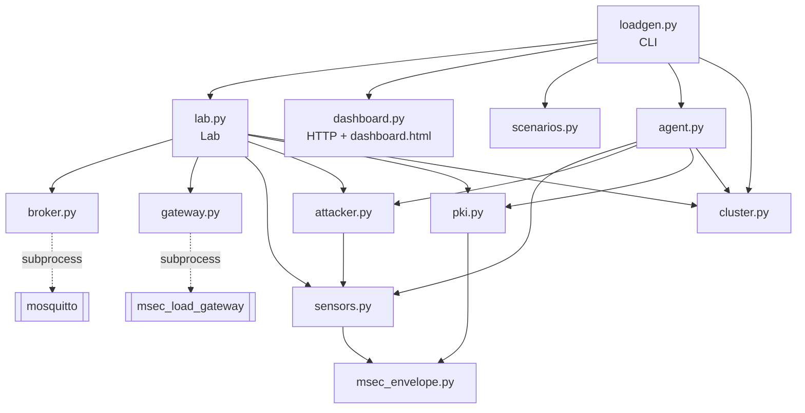

# Load lab — components

All modules live in `tools/loadgen/` and import each other by name (run from
that directory or via `loadgen.py`).



---

## `loadgen.py`

Entry point. Subcommands `live`, `matrix`, `scenarios`, `agent` (see
[overview](overview.md#commands-loadgenpy)).

- `parse_value(text)` — `true/on/yes` → `True`, `false/off/no` → `False`, then
  int, float, else string.
- `parse_assignment("section.key=value")` — validates section/key against
  `SPEC`.
- `load_config(args)` — defaults < `--config` < `--preset` < `--set` (the preset
  is computed on the merged config, then `--set` re-applied).
- `control_server(args, config)` — starts a `ControlServer` only when the config
  uses agents.
- `cmd_live` — binds the HTTP server first (fail before starting anything),
  starts the lab, prints the dashboard URL and a `curl` example, optionally
  opens the browser; `SIGTERM`/Ctrl-C stop everything.
- `cmd_matrix` — see [configuration](configuration.md#matrix-behaviour-with-startup-only-keys);
  writes CSV and prints a Markdown table.
- `cmd_scenarios` — runs `scenarios.run`, writes `.md` and `.csv`, exits
  non-zero listing failed scenarios.
- `cmd_agent` — `agent.run_agent`; a `FatalAgentError` (wrong fingerprint or
  token) exits.

## `lab.py`

The orchestrator.

| Element | Description |
|---|---|
| `DEFAULTS`, `SPEC`, `STARTUP_ONLY`, `BROKER_KEYS` | schema (see [configuration.md](configuration.md)) |
| `PACKET_OVERHEAD = 512`, `ROTATION_GRACE_S = 3.0` | constants |
| `hardened(config)`, `PRESETS` | the hardened preset |
| `validate(patch)`, `merged(base, patch)` | validation and merge |
| `parse_revoked`, `advertised_host`, `uses_agents`, `describe` | helpers |
| `Lab.start()` | claim agents → CA (cluster identity's or new) → `pki.generate` → `Broker.start` → `GatewayProcess` → fleet (local `SensorFleet` or `RemoteSensors` per agent, sensors split `ids[i::n]`) → attacker → sampler thread |
| `Lab.apply(patch)` | validate, compute changes, perform minimal actions, log events; returns human-readable descriptions (`"transport.mode: plain → tls"`) |
| `Lab.apply_preset(name)` | `apply(PRESETS[name](config))` |
| `Lab._rotate(old, new)` | new keys for active sensors, install everywhere, switch senders, revoke old ids after 3 s in a timer thread |
| `Lab._revoke(sensors)` | revoke their key ids at the gateway, rewrite passwd and CRL |
| `Lab._sampler()` | every second: fleet poll, gateway latest stats, attacker poll, broker CPU → `history` point (rates computed between samples; counter resets handled) |
| `Lab.state(since)` | snapshot for the dashboard |
| `Lab.measure(settle, duration)` | one matrix/scenario cell (see [dashboard-and-api.md](dashboard-and-api.md#measurement-columns)) |
| `Lab.stop()` | stop attacker, fleet, gateway, broker (best effort); remove temp workdir |

All public operations hold `Lab.lock` (an `RLock`).

## `broker.py`

`Broker(workdir, pki, host, port)` manages a private Mosquitto.

Generated `mosquitto.conf` (order matters):

```
per_listener_settings false
persistence false
log_dest stderr
log_type error
max_queued_messages 100000        # a slow gateway shows as latency, not loss
set_tcp_nodelay true              # avoids 14–30 ms Nagle/delayed-ACK stalls with 2+ subscribers
sys_interval <10 | 0>
allow_anonymous <false if auth else true>
[max_packet_size N]
[acl_file <workdir>/broker/acl]   # only with acl
[password_file <workdir>/passwd]  # only with auth
listener <port> <host>
[max_connections N]               # listener options after `listener`
[use_username_as_clientid true]
[cafile/certfile/keyfile, tls_version tlsv1.x]           # tls, mtls
[require_certificate true, use_identity_as_username true, crlfile …]   # mtls
```

ACL file (Mosquitto syntax, `%u` = username):

```
pattern readwrite open/#
pattern write restricted/sensors/%u/#
pattern read restricted/actuators/%u/#

user gateway
topic read restricted/sensors/#
topic write restricted/actuators/#
```

The username is the *claimed* name without auth, the verified name with
passwords, and the certificate CN with mtls.

| Method | Behaviour |
|---|---|
| `start(**settings)` | refuse if the port is in use; write config; spawn (environment from `_env()`); wait ≤ 5 s for the port |
| `_env()` | with tls/mtls and `tls_version = 1.2`: `OPENSSL_CONF` → `openssl-tls12.cnf` (`MaxProtocol = TLSv1.2`), because Mosquitto's `tls_version` is only a minimum; with key logging on: `LD_PRELOAD` of the key-log shim |
| `apply(**change)` | `""` if nothing changed; **restart** if any of `mode, tls_version, clientid_binding, max_packet, max_connections` changed, or `revoked` changed under mtls; else rewrite and `SIGHUP` (**reload**) |
| `restart()`, `stop()` | terminate (5 s) then kill |
| `cpu_seconds()` | utime + stime from `/proc/<pid>/stat` |

Log: `<workdir>/broker/mosquitto.log`.

## `gateway.py`

`GatewayProcess(binary, pki, host, port, config, verbose, sending_key=0)`
spawns `msec_load_gateway` with every setting on the command line (same port
for plain/tls/mtls listeners, gateway certificate and key, `--credentials`,
`--keys`, `--control stdin --stats json --report 1000`), waits up to 10 s for
`READY`, and runs two reader threads:

- stdout: JSON lines; `type: stats` → `latest`; `type: summary` → queue.
- stderr: kept in a 5000-line ring buffer (shown if startup fails).

Methods map 1:1 to the stdin protocol: `set(key, value)` (bools → on/off),
`add_key(line)`, `revoke_key(id)`, `reconnect()`, `reset()`, `summary()`
(blocks ≤ 10 s), `stop()` (`quit`, then kill after 10 s).

## `sensors.py`

`SensorFleet(ids, processes, **settings)` runs N sensors across `spawn`ed
worker processes (`ids[i::processes]` each).

Per worker (`_worker`):

- Reads its key file; builds one `Sensor` per id with a `Protector` (key id =
  `epoch × 10⁶ + n`) and a `Verifier` for commands (accepted mode = the current
  protection, freshness/replay as configured, `allowed_senders` = the gateway's
  key ids).
- Drives all sockets **by hand from one loop** (`loop_read/loop_write/loop_misc`)
  instead of a paho thread per connection, which is far cheaper in Python.
- Publishes on a global schedule: period = 1 / (sensors × rate), round robin;
  if more than 250 ms behind it **skips** the backlog (counted as `skipped`)
  rather than bursting; sensors that are not up are skipped too.
- Plaintext = `(time_ns + clock_offset_ns)` as u64 BE + zero filler to
  `payload` bytes; sealed with the sensor's `Protector`.
- Housekeeping every 50 ms: reconnect sensors that are down (every 1 s),
  process CONNACK / commands / keep-alives, detect lost connections (`kicked`
  counts connections lost while up, e.g. session takeover) and connect
  timeouts (5 s).
- Reports a `WorkerReport` every 0.5 s.
- Control messages (`update`): `transport` (reconnect all), `rate`, `payload`,
  `zone` (re-subscribe commands), `protection`/`freshness`/`replay` (policy),
  `clock_offset_ns`, and rotation steps `add_keys` → `epoch` → `drop_keys`.

Each `Sensor` is also an **actuator**: subscribes to
`<zone>/actuators/sensor-<n>/cmd` and on each command runs the `Verifier`
(unless protection is `none`), then counts `cmd_ok`, `cmd_rejected` (by
reason), `cmd_forged_ok` (`FORGED-C` at offset 8) or `cmd_replay_ok` (command
id seen before, 4096-entry FIFO).

Every sensor connects with its username and password (and certificate under
mtls) **always**, so switching broker authentication never interrupts it.

`make_client(client_id, transport, username, password, cert)` builds a paho
v2-callback client for the current transport (MQTT 3.1.1 or 5, TLS with
`CERT_REQUIRED` and the lab CA, client cert only under mtls). `summarize`
adds up worker or agent reports.

## `attacker.py`

`Attacker(**settings)` runs "mallory" in its own `spawn`ed process. It knows
the broker address and the **public CA certificate only**: no password, no
client certificate, no payload key.

| Behaviour | Detail |
|---|---|
| connect | client id `mallory-<random>`, username `mallory` or `gateway` (impersonate), no password; paho `connect_async` + `loop_start`, reconnect 1–2 s |
| eavesdrop | subscribe `#` on connect; count every message (`received`); keep the last 500 `/sensors/` messages for replay |
| inject | at `inject_rate`: publish `send_time ‖ "FORGED!!" ‖ 8 zero bytes` to `<zone>/sensors/sensor-1/temp` |
| replay | at `replay_rate`: re-publish a random captured message unchanged |
| status | `detail`: "connected as …", "refused by broker: <reason>", "kicked out by broker", "cannot connect: no client certificate", "cannot connect: TLS handshake or network" |

Each defence shows up in its reports: auth/mtls keep it off the broker, the ACL
starves `#` and blocks injections, payload protection makes what it sees
unreadable and bounces its forgeries and replays.

## `pki.py`

Test credentials for a run (ECDSA P-256 so issuing hundreds of certificates is
fast). **Test use only**: private files are written 0600, unencrypted.

| Function / class | Purpose |
|---|---|
| `CertificateAuthority.create/load/save` | self-signed CA (CN `msec-loadtest-ca`, 365 days, `pathlen 0`) |
| `ca.issue(cn, public_key, server=, names=)` | leaf (2 days) with `serverAuth` or `clientAuth`, optional SAN (IPs and DNS names) |
| `ca.issue_from_csr(csr_pem, expected_cn)` | sign a CSR only if its signature is valid and its subject is exactly `CN=expected_cn` |
| `ca.crl(revoked_certs)` | CRL valid for the lab's lifetime |
| `make_csr(cn)` | key + CSR (used by agents) |
| `generate(root, ca, sensor_ids, local_ids, server_names)` | writes everything below; returns `(Pki, KeySet)` |
| `make_keys(ids, epoch)` | per device (gateway = 0): AES key, Ed25519 private + public; id = `epoch × 10⁶ + device` |
| `gateway_view(keys)` | every aead and public key, **only the gateway's** private key |
| `device_view(keys, ids)` | each device's own aead + private key, plus the gateway's aead (downlink group key) and public key |
| `write_keys`, `write_passwd` (via `mosquitto_passwd -U`), `write_crl`, `read_credentials` | file writers/readers |

Files per run (`Pki` paths):

```
pki/ca.crt                     trust anchor (public)
pki/server.{crt,key}           broker; SAN localhost, 127.0.0.1 + advertised names
pki/clients/<name>.{crt,key}   gateway and local sensors (CN = MQTT username)
pki/issued/<name>.crt          every client certificate issued (for the CRL)
pki/crl.pem                    revoked client certificates
credentials.txt                "<user> <password>" (gateway + every sensor)
passwd                         same minus revoked users, hashed
keys.txt                       gateway view
device-keys.txt                local sensors' device view
```

Remote sensors are not given certificates here; they enrol via CSR so their
private keys never leave the agent.

## `msec_envelope.py`

Python implementation of the envelope, byte-compatible with the C++ one
(see [protocol spec](../protocol/envelope-format.md)).

| Element | Description |
|---|---|
| constants | `MAGIC`, `VERSION=2`, `NONCE_SIZE=12`, `KEY_SIZE=32`, `TAG_SIZE=16`, `SIGNATURE_SIZE=64`, `FIXED_HEADER=25`, `REPLAY_WINDOW=64`, mode names and wire values |
| `KeySet` | dicts `aead`, `sign_private`, `sign_public`, `owners`; `add`, `remove`, `lines`, `subset`, `merge` |
| `add_line`, `read_keys` | key-file parser shared with the C++ gateway's format |
| `public_key(private)` | Ed25519 public key from a seed |
| `Protector(protection, key_id, key, signing_key, clock_ns=, random=, sequence=)` | seals for one sender; sequence starts at current µs unless injected; `set_protection` (sequence keeps counting), `rekey` (rotation), `protect(topic, payload)`; `none` returns the payload unchanged |
| `Verifier(keys, accept, freshness=, replay=, allowed_senders=, max_age_ms=60000, max_skew_ms=5000, clock_ns=)` | opens with the same checks and order as `SecurityLayer`; raises `Rejected(reason)` with C++ `ErrorCode` names; `forget(key_id)` |

## `keylog.py`, `capture.py`, `pcapgen.py`

| Module | Role |
|---|---|
| `keylog.py` | `activate(path)` sets `SSLKEYLOGFILE` (file 0600) for this process and its children; `enable(ctx)` makes a Python `SSLContext` log to it (used by `sensors.make_client`, the agent and the control server); `library_for(gateway)` locates `libmsec_sslkeylog.so`; `preload_env(lib)` builds the `LD_PRELOAD` environment for mosquitto and the gateway |
| `capture.py` | `Capture(path, iface, ports)`: starts `dumpcap`, collects lab events (`Lab.listeners`), and on `stop()` writes `<name>.events.tsv` and runs `editcap --inject-secrets tls,<keys> -a <frame>:<comment> …`; `frame_times()` is a minimal pcapng timestamp reader used to place the comments |
| `pcapgen.py` | `Capture`/`TcpConnection` write valid Ethernet/IPv4/TCP frames; MQTT 3.1.1 encoders; `Recorder` relays a real TCP connection and records its bytes; `sample()` builds the demonstration capture |

`Lab.listeners` receive the text of every lab event; `Lab.mark(text)` records
events that are not configuration changes (scenario starts, matrix cells).

See [network-analysis.md](../network-analysis.md).

## `cluster.py`, `agent.py`

See [distributed-agents.md](distributed-agents.md).

## `scenarios.py`

See [scenarios.md](scenarios.md).

## `dashboard.py`, `dashboard.html`

See [dashboard-and-api.md](dashboard-and-api.md).

## Tests (`tools/loadgen/tests`)

```bash
tools/loadgen/.venv/bin/python -m unittest discover -s tools/loadgen/tests -t tools/loadgen
```

| File | Tests |
|---|---|
| `test_envelope.py` | shared vectors reproduced; round trip in every mode; tampering, topic rebinding, unknown keys; mode policy and plaintext; replay window and reordering; freshness; allowed senders; key-file round trip |
| `test_lab_config.py` | defaults valid and equal to level K0; security levels K0–K10 match the report; choices as text or numbers; bad values rejected; revoked list parsing and bounds; flattening; hardened preset turns everything on; limits follow the load; packet limit must fit the payload |
| `test_pki.py` | gateway never holds sensor private keys; device views; epochs never reuse ids; CRL and passwd generation (needs `mosquitto_passwd`); listener options follow `listener`; ACL off ⇒ no `acl_file`; `apply` chooses reload vs restart; TLS 1.2 is capped via `OPENSSL_CONF` |
| `test_wireshark.py` | dissector on a generated capture (modes, overhead, replay, deliveries, forgery, malformed); real TLS 1.2 / 1.3 sessions to `broker.Broker` decrypted with the shim's secrets; capture post-processing (timestamps, embedded secrets, comments) — needs tshark |

No broker is needed (the passwd test is skipped without `mosquitto_passwd`).
