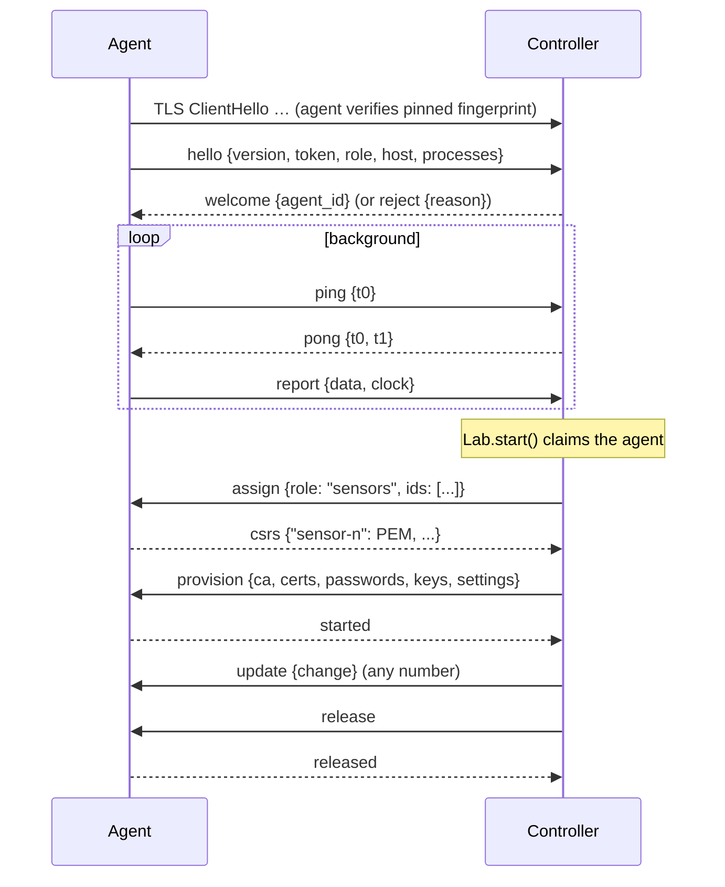

# Load lab — sensors and attackers on other machines

For clean numbers, keep the **controller** (broker + gateway + dashboard) free
of sensor load, and make the attacker a real network peer. Other machines run
`loadgen.py agent`.

```bash
# controller
tools/loadgen/.venv/bin/python tools/loadgen/loadgen.py live \
    --set broker.host=0.0.0.0 --set load.sensors=500 \
    --set cluster.sensor_agents=2 --set cluster.attacker_agents=1
#   → prints: loadgen.py agent --controller 192.168.1.10:8089 --token … --fingerprint … --role sensors|attacker

# each agent machine (repo checkout + venv)
tools/loadgen/.venv/bin/python tools/loadgen/loadgen.py agent \
    --controller 192.168.1.10:8089 --token … --fingerprint … --role sensors
```

The lab starts once the configured agents have joined (`cluster.join_timeout`,
600 s). Sensors are split evenly between sensor agents (`ids[i::n]`); each
attacker agent runs one attacker. Agents serve one run after another and
reconnect on their own, so start them once and run as many `live`/`matrix`/
`scenarios` sessions as you like (`matrix` re-provisions them for startup-only
variations such as `--vary load.sensors=100,500`).

Network: agents must reach the controller on the MQTT port (18830) and the
control port (8089).

## Components

| Side | Class | Role |
|---|---|---|
| controller | `ControllerIdentity` | CA, control certificate (CN `msec-loadtest-controller`) and token, persisted in `--state-dir` (`build/loadtest/controller/`, dir 0700, key files 0600); `--new-token` rotates the token |
| controller | `ControlServer` | TLS listener (min TLS 1.2), one thread per agent, registry of `AgentHandle`s, `claim(role, count, timeout)` reserves idle agents |
| controller | `RemoteSensors`, `RemoteAttacker` | same interface as `SensorFleet` / `Attacker`, backed by an agent |
| controller | `FleetGroup`, `AttackerGroup` | aggregate several local/remote members into one fleet / one attacker view |
| agent | `session()`, `Run`, `ClockEstimator` | connect, authenticate, enrol, run, report, estimate clock offset |

## Trust bootstrap

1. **Pin first.** The agent opens TLS with CA/hostname verification replaced
   by pinning: it computes the SHA-256 of the controller's DER certificate and
   compares it (constant time) with `--fingerprint` **before sending
   anything**. A machine impersonating the controller learns nothing, not even
   the token. A mismatch is fatal (no retry).
2. **Token.** The agent's `hello` carries the token; the controller compares it
   with `hmac.compare_digest`. Wrong token, protocol version or role ⇒
   `reject{reason}` and close; the agent treats a rejection as fatal.
3. **CSR enrolment.** For each assigned sensor, the agent generates an ECDSA
   P-256 key **locally** and sends only a CSR. The controller signs it only for
   exactly the assigned identity (`CN=sensor-<n>`, valid CSR signature) and
   records the certificate for later revocation (CRL). **Sensor private keys
   never leave the agent.**
4. **Shared secrets over the verified channel.** Secrets the controller must
   know anyway — MQTT passwords, AES payload keys, the sensors' Ed25519 payload
   signing keys (generated by the controller's `make_keys`) — are sent only
   over this channel, only for the agent's own sensors (`device_view`: own
   keys + the gateway's downlink AES key and public key). Attacker agents
   receive only the public CA certificate.
5. **Ephemeral storage.** Received credentials live in a `mkdtemp` directory
   (0700, private files 0600) deleted when the run ends or the agent exits.

## Protocol

Newline-delimited JSON over the TLS connection; `PROTOCOL_VERSION = 2`
(version 2: key files carry kinds and owners).



| Message | Direction | Fields |
|---|---|---|
| `hello` | A→C | `version`, `token`, `role` (`sensors`/`attacker`), `host`, `processes` |
| `welcome` / `reject` | C→A | `agent_id` / `reason` |
| `assign` | C→A | `role`, `ids` (sensors only) |
| `csrs` | A→C | `{name: CSR PEM}` |
| `provision` | C→A | `ca`; sensors also `certs`, `passwords`, `keys` (key-file lines), `settings` (transport without `ca` — the agent substitutes its own path) |
| `started` | A→C | |
| `update` | C→A | `change` (same keys as `SensorFleet.update` / `Attacker.update`) |
| `release` / `released` | C→A / A→C | end of run; agent stops workers and deletes the temp dir |
| `ping` / `pong` | A→C / C→A | `t0` (agent ns) / `t0`, `t1` (controller ns) |
| `report` | A→C | `data` (fleet or attacker poll), `clock` (`offset_ns`, `uncertainty_ns`, `samples`, `corrected`) |
| `error` | A→C | `message` — a failed command; the controller raises it in `expect()` |

Timeouts: `csrs` 120 s, `started` 60 s, `released` 15 s.

## Clock correction

The gateway computes one-way latency against **its own** clock, so remote
sensors must stamp messages in controller time.

- The agent pings every 50 ms for the first 40 pings, then every 2 s.
- For each pong: `rtt = t2 − t0`, `offset = t1 − (t0 + t2)/2` (NTP-style).
- The estimate is the sample with the **lowest RTT** in the last 60 s;
  uncertainty = that RTT / 2.
- The offset is pushed to the sensor workers (`clock_offset_ns`) whenever it
  moves by more than 5 µs; sensors add it to their send timestamps.
- The dashboard shows each agent's offset ± uncertainty; treat latency
  differences smaller than the uncertainty as noise.
- With PTP-synchronised clocks, start agents with `--no-clock-correction`.

## Failure handling

- Agent: `OSError`/`SSLError` ⇒ "controller unreachable; retrying" every 2 s;
  `FatalAgentError` (fingerprint mismatch, rejection) ⇒ exit.
- Controller: a disconnected agent is removed from the registry; its
  `RemoteSensors.poll()` reports `up = 0` and "agent disconnected"; `claim()`
  waits (announcing progress) until enough idle agents are present or the
  timeout/stop fires.
