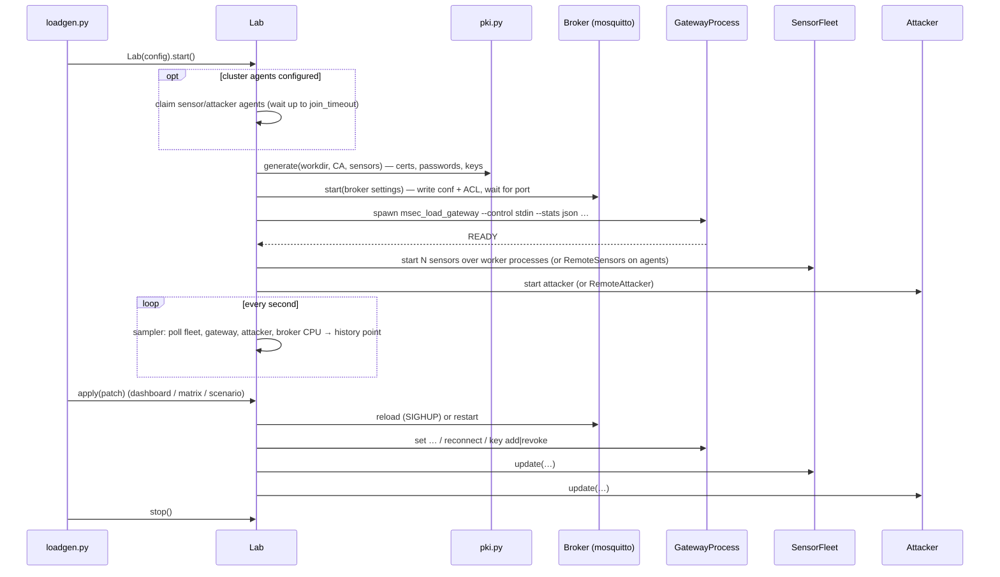

# Load lab — overview

`tools/loadgen` runs a **complete system on one or more machines** and lets you
switch every security feature on or off, from a config file at startup or
**while traffic flows**, and watch the effect on throughput, latency, CPU,
rejections and on what an attacker achieves.

```
mock sensors (Python) ─▶ private mosquitto ─▶ msec_load_gateway (C++) ─▶ metrics
     ▲  (also actuators)          ▲                    │ downlink commands
     └─────────────────────────────┼────────────────────┘
              attacker ────────────┘  subscribes to '#', injects, replays, impersonates
```

## Documents in this folder

| Document | Contents |
|---|---|
| this page | purpose, setup, the four commands, how a run works |
| [configuration.md](configuration.md) | every setting, its default, how it is applied, validation, presets |
| [components.md](components.md) | each Python module in detail |
| [scenarios.md](scenarios.md) | the 16 attack-vs-defence experiments |
| [dashboard-and-api.md](dashboard-and-api.md) | the web dashboard, the HTTP API, metric definitions, matrix columns |
| [distributed-agents.md](distributed-agents.md) | running sensors/attackers on other machines: trust bootstrap, protocol, clock correction |
| [../network-analysis.md](../network-analysis.md) | recording runs for Wireshark (`--capture`), TLS decryption, the dissector |

## Requirements

- The `bench` build of `msec_load_gateway` (`cmake --preset bench && cmake --build --preset bench`).
- Mosquitto 2.0.x (`mosquitto`, `mosquitto_passwd`; the lab starts its own
  private instance on port 18830 and never touches the system broker).
- Python ≥ 3.11 with `paho-mqtt>=2.1,<3` and `cryptography>=41`
  (`tools/loadgen/requirements.txt`) in `tools/loadgen/.venv`.
- Linux (broker CPU is read from `/proc`).

```bash
python3 -m venv tools/loadgen/.venv
tools/loadgen/.venv/bin/pip install -r tools/loadgen/requirements.txt
```

Or just `./run.sh`, which checks the tools, configures and builds the `bench`
preset if needed, creates the venv, installs requirements and starts `live`
with `lab.example.toml`, 100 sensors and the browser opened. Extra arguments
are forwarded (e.g. `./run.sh --preset hardened`).

## Commands (`loadgen.py`)

| Command | Purpose | Output |
|---|---|---|
| `live` | run the lab with the web dashboard; change settings from the page or `POST /api/config` | dashboard at `http://127.0.0.1:8088/` |
| `matrix` | apply each combination of `--vary` values in turn and measure a window per cell | CSV in `build/loadtest/matrix-<time>.csv` + Markdown table on stdout |
| `scenarios` | run the named experiments and report PASS/FAIL against predictions | `build/loadtest/scenarios-<time>.{md,csv}`; exit status ≠ 0 on failure |
| `agent` | serve sensors or an attacker for a remote controller | — |

Common options (`live`, `matrix`, `scenarios`):

| Option | Meaning |
|---|---|
| `--config FILE` | TOML config (see `lab.example.toml`) |
| `--set section.key=value` | override one setting; repeatable; values parsed as bool (`true/on/yes`, `false/off/no`), int, float, else string |
| `--preset hardened` | every defence on, limits derived from the load |
| `--gateway PATH` | gateway binary (default `build/bench/apps/load_gateway/msec_load_gateway`) |
| `--verbose` | gateway logs every rejection |
| `--state-dir DIR` | controller CA/cert/token (default `build/loadtest/controller`) |
| `--new-token` | rotate the agent join token |
| `--capture [FILE.pcapng]` | record the run with dumpcap; TLS secrets and a comment per lab event are embedded ([guide](../network-analysis.md#4-recording-a-lab-run)) |
| `--capture-iface IFACE` | default `lo`, or `any` with agents |
| `--keylog FILE` | every TLS endpoint writes its secrets here (default with `--capture`: `<capture>.keys`) |

Command-specific:

| Command | Options |
|---|---|
| `live` | `--http-port` (8088), `--http-host` (127.0.0.1 — no auth, keep it local), `--workdir DIR` (keep certificates, keys and logs), `--open` |
| `matrix` | `--vary section.key=v1,v2,…` (repeatable, cartesian product; default `transport.mode × payload.protection`), `--settle` (3 s), `--duration` (10 s), `--out` |
| `scenarios` | `--list`, `--only a,b`, `--settle` (3 s), `--duration` (6 s), `--out` (path without extension) |
| `agent` | `--controller HOST[:PORT]`, `--token`, `--fingerprint`, `--role sensors\|attacker`, `--processes` (CPU count), `--no-clock-correction` |

Configuration precedence: **defaults < `--config` < `--preset` < `--set`**. The
preset is computed from the already-merged config (its limits depend on the
load), and explicit `--set` values are re-applied on top so they win.

## Examples

```bash
# live, 100 sensors, TLS from the start
tools/loadgen/.venv/bin/python tools/loadgen/loadgen.py live \
    --config tools/loadgen/lab.example.toml --set load.sensors=100 --set transport.mode=tls

# drive it from a script while it runs
curl -s localhost:8088/api/config -d '{"transport": {"mode": "mtls", "auth": true}}'
curl -s localhost:8088/api/preset -d '{"name": "hardened"}'

# matrix: 3 × 2 × 3 = 18 cells
tools/loadgen/.venv/bin/python tools/loadgen/loadgen.py matrix \
    --set load.sensors=100 --set load.rate=100 \
    --vary transport.mode=plain,tls,mtls --vary transport.auth=off,on \
    --vary payload.protection=none,auth_only,encrypt --settle 3 --duration 10

# scenarios (what CI runs, smaller)
tools/loadgen/.venv/bin/python tools/loadgen/loadgen.py scenarios \
    --set load.sensors=10 --set load.rate=10 --settle 3 --duration 5
```

## How a run works



`Lab.apply()` validates the patch and performs **exactly the actions each
change needs** (see [configuration.md](configuration.md#how-each-setting-is-applied)).
`Lab.measure(settle, duration)` waits `settle` seconds, `reset`s the gateway
window, snapshots fleet/attacker/broker counters, waits `duration`, then asks
the gateway for its `summary` and computes the result row.

## Topics and identities

| Item | Value |
|---|---|
| sensor *n* | client id and username `sensor-<n>`; certificate CN `sensor-<n>` |
| uplink topic | `<zone>/sensors/sensor-<n>/temp` |
| downlink topic | `<zone>/actuators/sensor-<n>/cmd` |
| gateway | `gateway`; subscribes `open/sensors/#`, `restricted/sensors/#` |
| attacker | `mallory-<random>` client id, username `mallory` (or `gateway` when impersonating); no password, no client certificate |
| zones | `open/` (everyone reads/writes when the ACL is on) · `restricted/` (per-client) |
| sensor plaintext | u64 BE send time (ns) + zero padding up to `load.payload` bytes |
| attacker forgery | u64 send time + `FORGED!!` + 8 zero bytes |

## Caveats

- On one machine, the Python sensors compete with the gateway and broker for
  CPU; use agents for clean absolute numbers.
- `loss_pct` and `leak_pct` are accurate to about ±0.5 s of the window (sensors
  report twice a second).
- Sensor sequence numbers start from the current time in µs, so a restarted
  sensor keeps moving forward through the gateway's replay window.
- Credentials are generated fresh per run in a temp directory (deleted on stop
  unless `--workdir` is given). Test use only: stored unencrypted, mode 0600.
