# Revisão do relatório da Parte 2 — primeira versão

Revisão só de leitura: **nada foi alterado no repositório**. Base: `report/parte2/` no commit
`0a3f8b6` (depois do PR #14), campanha `pi5-20261113`.
Referências usadas: critérios de avaliação (P-P2), template ISCTE (SRSI2223-TG-Template-PT.docx)
e o relatório da Parte 1 (`report/main.pdf`).

Como foi feita, em 4 passagens:
1. conformidade com o template e os critérios;
2. cada número do texto conferido com `gerado/pi5/*.csv|md` e `results/pi5-20261113/*.csv`;
3. coerência com a Parte 1 (secções, QP1–QP5, H1–H5, equações, tabelas);
4. texto, tabelas e figuras.

A plataforma de referência (computador de secretária) está a ser medida e fica fora desta
revisão.

Os recortes do PDF (`report/parte2/main.pdf`, versão do commit `0a3f8b6`) estão em [`img/`](img/), ao lado deste ficheiro; o trecho em causa está realçado a amarelo. As páginas indicadas referem-se a essa versão do PDF.

Legenda:
- **[crítico]**: afeta diretamente a nota ou é um erro factual;
- **[importante]**: fragiliza um critério;
- **[menor]**: acabamento.

---

## Resumo

No geral, os números estão muito bem: das cerca de 120 afirmações numéricas conferidas, só 3 não
batem com os dados (R4, R5, R6). Os problemas principais são de **forma e template**: as
referências estão vazias e falta o glossário. Há também uma oportunidade perdida: **a Parte 2 não
dialoga com a literatura**. Nem sequer o faz onde refuta uma hipótese que a Parte 1 apoiava num
artigo citado (H4).

| # | Gravidade | Onde | Problema |
|---|---|---|---|
| R1 | crítico | todo o relatório | 0 citações: a secção "Referências" sai vazia no PDF |
| R2 | importante | `main.tex` | falta o Glossário, que o template torna obrigatório |
| R3 | importante | `07-hipoteses.tex:45-53` | H4 é refutada sem discutir `prantl2021performance`, o artigo em que a Parte 1 a baseou, nem dizer em que condições a hipótese se mantém (≈ 430 mensagens por ligação, ver R3.1) |
| R4 | importante | `04-custo.tex:86-88` | K10 sustentou 35 000 msg/s numa subida, não 30 000 |
| R5 | importante | `08-validacao.tex:13-17`, `02-prototipo.tex:143-146` | o texto diz "61 testes passaram"; passaram 54 e 7 foram ignorados. Retirar a única menção ao Wireshark/`tshark` no PDF (R5.1) |
| R6 | menor | `05-protecao.tex:38` | "Só K8 e seguintes" inclui K10, que não impede a inundação |
| R7 | importante | `06-criterio.tex` | as equações de S(c), custo(c) e c* não são retomadas |
| R8 | importante | `04-custo.tex:90-113`, `05-protecao.tex:55-117` | duas tabelas de resultados escritas à mão |
| R9 | importante | `01-introducao.tex` | falta o parágrafo com a estrutura do documento (template) |
| R10–R18 | menor | vários | ver abaixo |

---

## 1. Conformidade com o template e os critérios

### R1 [crítico] Referências vazias
`grep -c '\cite' parte2/seccoes/*.tex` dá 0 em todas as secções. Por isso, com o `bibtex`, a
secção "Referências" do PDF (pág. 23) sai só com o título. O template diz que esta secção é
OBRIGATÓRIA.

*No PDF: relatório pág. 23 (ficheiro pág. 27), secção Referências: só o título.*

**Correção:** citar onde faz sentido. As entradas citadas na Parte 1 já estão em
`../referencias.bib`; as normas e o software do 2.º ponto têm de ser acrescentadas, se ainda lá
não estiverem.
- `01-introducao`: o problema e a lacuna L5, com 2–3 referências da Parte 1.
- `02-prototipo`: Mosquitto, Paho, OpenSSL, RFC 8439 (ChaCha20-Poly1305) e Ed25519.
- `03-metodo`:
  - SlowITe (`vaccari2020slowite`) no ataque de ocupação de ligações;
  - *bootstrap* de percentis.
- `07-hipoteses`: `prantl2021performance` em H4 (ver R3).
- Nova subsecção de discussão, "Comparação com trabalhos relacionados", em 07 ou 10:
  - comparar os nossos custos com os de `spielvogel2021tls`, `segarra2020mqttz`,
    `malina2019secure`, `sadio2019lightweight` e `javadi2026cmap`;
  - retomar a Tabela 13 da Parte 1;
  - isto também reforça o critério "Testes e comparativos práticos de resultados" (6 valores).
- `\cite{mqttsecure2026repo}` no anexo de reprodução.

### R2 [importante] Falta o Glossário
O template tem a ordem Resumo → Palavras-chave → Índice → **Glossário** → Introdução. O relatório
usa muitas siglas: MQTT, TLS, mTLS, ACL, AES-GCM, GMAC, AEAD, NEON, CRL, PKI, QoS, NTP, PTP, RTT,
IC, p50/p99, CPU…

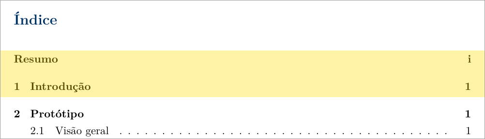
*No PDF: relatório pág. ii (ficheiro pág. 3), Índice. Entre o Resumo e a Introdução falta o Glossário.*

**Correção:**
- uma página "Glossário" a seguir ao índice, partindo de `docs/glossary.md`;
- incluir também os símbolos: K0–K11, S(c), custo(c), π_a(c), Δa, Δs, R_alvo, L_max, A1–A13;
- basta uma tabela simples de duas colunas, sem pacote novo.

### R9 [importante] Introdução sem estrutura do documento
O template pede que a introdução diga qual é o problema, como é abordado e qual é a **estrutura do
documento**. A introdução trata os dois primeiros pontos (através de QP1–QP5). Não diz o que contêm
as secções 8 (validação), 9 (ameaças) e 10 (conclusões), nem o anexo.

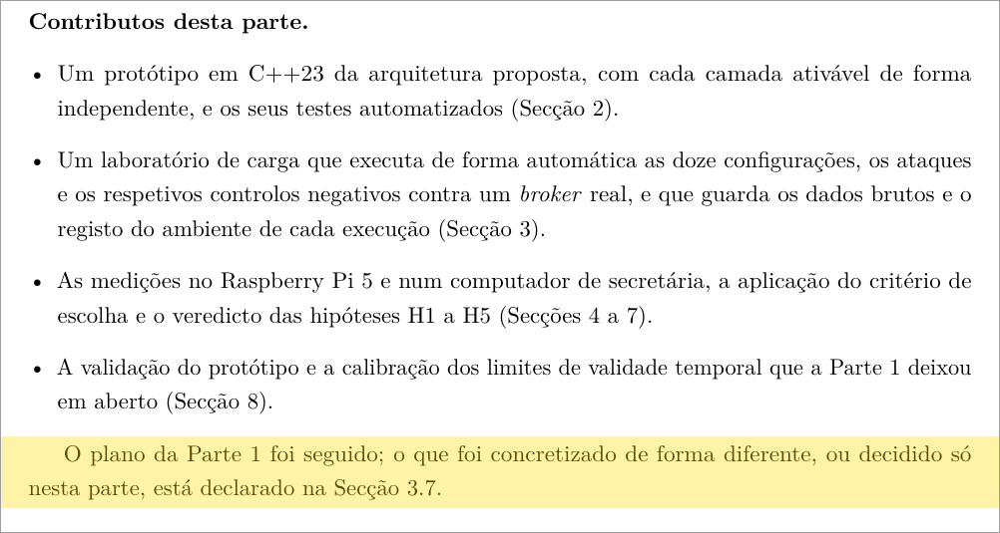
*No PDF: relatório pág. 1 (ficheiro pág. 5), fim da §1. A introdução acaba sem o parágrafo de estrutura do documento.*

**Correção:**
- um parágrafo final do tipo "O documento está organizado assim: …";
- uma frase que relembre o problema sem obrigar a ler a Parte 1.

### Matriz critério → evidência

| Critério P-P2 | Valores | Onde está a evidência | Avaliação |
|---|---|---|---|
| Implementação | 8 | §2 (Fig. 1, tabela do que foi implementado, decisões, testes) e o repositório | Forte. Sugestões: 1–2 frases sobre a dimensão (módulos, linhas, presets CMake); um pequeno excerto ou diagrama do formato do envelope de 25 octetos |
| Testes e comparativos práticos | 6 | §4, §5, §6, §7 | Forte nos dados. **Fraco na comparação com outros trabalhos** (R1/R3). O R3.1 dá a essa comparação um argumento quantitativo (o ponto de equilíbrio do TLS). A 2.ª plataforma está a ser medida |
| Validação do protótipo | 4 | §8, tabela de cenários, `results/validation/` | Forte. Corrigir R5 |
| Relatório / vídeo | 2 | — | **O vídeo não está no repositório.** Sugestão: roteiro de 5 min (problema → arquitetura → demo `hardened` contra o ataque → K8/K9 → H4/H5), com link no README e no anexo |

---

## 2. Rigor dos números (conferidos com os CSV)

Valores conferidos e corretos:
- **tabela de resumo:** K0 24,0 µs, 122 µs e 173 µs; K1 31,9; K10 35,2; grupo entre 39,1 e 42,6;
  K9 192,6, ou seja, 8×K0;
- **custo marginal:** todo;
- **interações:** −0,5 [−1,3; 0,4] e −2,4 [−2,9; −2,0];
- **H1–H5:**
  - 7,2 [6,8; 7,8];
  - 25/149 = 17 %;
  - 4,7×;
  - 430 mensagens = 3,41 ms / 7,9 µs;
  - 1 559 de 1 814, ou seja, ~260/s e ~0,2 %;
- **critério:** K10 0,64/1,40; K5 0,73/1,76; K8 1,00/1,80; 3,9 e 0,14; K9 5,9; K11 +2 %;
- **microbenchmarks:** 5,6/6,0/13,0/118; NEON 7,5/12,4/88; ChaCha 6,9–7,6 e 21,7–22,4; 38 a 4 KiB;
- **proteção:** S(c) com os pesos de 0,5;
- **cenários:** os 39 e os seus valores;
- **calibração:** 43,2 ms dá Δa = 100; 289 ms dá Δs = 600 e Δa = 700;
- **campanha:** 4 h 55 min e 16 ppm.

### R4 [importante] K10 na subida de carga
`04-custo.tex:86-88` diz que "K6, K7 e K10 sustentaram 30 000 mensagens/s numa das três subidas".
Em `saturation.csv`, a repetição 2 de K10 sustentou **35 000** (700 msg/s por sensor, perda de
0,0 %, p99 de 19 ms) e só falhou a 800. Os valores de K6 e K7 estão corretos.

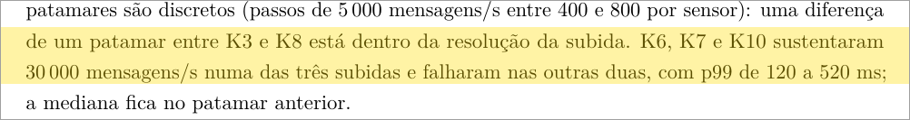
*No PDF: relatório pág. 10 (ficheiro pág. 14), §4.3.*

**Correção:** "K6 e K7 sustentaram 30 000 numa das três subidas, e K10 35 000; nas outras duas
falharam com p99 de 120 a 520 ms".

### R5 [importante] Testes em Python no Raspberry Pi
`08-validacao.tex:13-17` diz: "os 93 testes em C++ e os 61 testes em Python do laboratório
passaram […]; só os sete testes que dependem do `tshark` não correram". O registo diz
`Ran 61 tests … OK (skipped=7)`: **passaram 54 e 7 foram ignorados**.

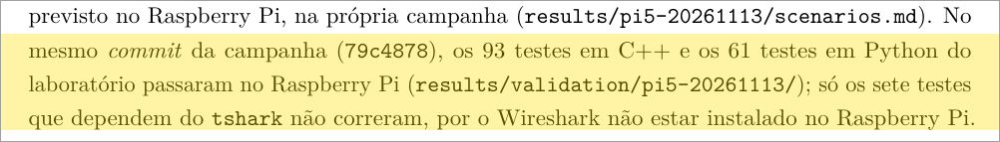
*No PDF: relatório pág. 18 (ficheiro pág. 22), §8.1.*

**Porque foram ignorados os 7:** a contagem coincide exatamente com os testes de
`tools/loadgen/tests/test_wireshark.py`: 4 na classe `Dissector` e 3 na classe `TlsDecryption`.
Todos têm `@unittest.skipUnless(TSHARK, …)`, e o `tshark` não está instalado no Pi. O registo
corre sem `-v`, por isso não imprime o motivo, mas os 7 `s` aparecem seguidos no fim, que é onde
`test_wireshark.py` fica por ordem alfabética. Estes testes cobrem só ferramentas opcionais de
inspeção com Wireshark: o dissetor `tools/wireshark/msec.lua`, o *shim* de registo de segredos TLS,
e `capture.py` / `--capture`. Nada disto interveio na campanha: o `manifest.json` regista
`"capture": null` e `"keylog": null`, e as medições de escuta e de broker ativo são feitas em Python
(`tools/loadgen/relay.py`).

**Correção:** ver R5.1. A entrega prática não deve mencionar esta dependência.

#### R5.1 Retirar do relatório as menções ao Wireshark / `tshark`
O Wireshark não é instrumento de medição nem faz parte do protótipo, por isso o relatório da
entrega prática não o deve mencionar. Verificação feita no código-fonte e no PDF
(`grep -i "wireshark|tshark|dumpcap|pcap|keylog|dissetor"` em `parte2/seccoes/*.tex`,
`parte2/gerado/pi5/*.tex` e `pdftotext parte2/main.pdf`): há **uma única menção**, em
`08-validacao.tex:15-17` (pág. ~20 do PDF). O "repetições capturadas" de `08-validacao.tex:82` não
tem nada a ver com isto. A Parte 1 não menciona o Wireshark.

**Alterações propostas:**

1. `08-validacao.tex:13-17`. Hoje:
   > No mesmo commit da campanha (79c4878), os 93 testes em C++ e os 61 testes em Python do
   > laboratório passaram no Raspberry Pi (results/validation/pi5-20261113/); só os sete testes que
   > dependem do tshark não correram, por o Wireshark não estar instalado no Raspberry Pi.

   Passa a:
   > No mesmo commit da campanha (79c4878), os 93 testes em C++ e os 54 testes em Python do
   > laboratório passaram no Raspberry Pi (results/validation/pi5-20261113/).

   A frase sobre o `tshark` é retirada por inteiro.

2. `02-prototipo.tex:143-146`, por coerência com a contagem acima. Hoje diz "73 testes em Python
   (61 do laboratório, 12 da análise)", e os 61 incluem os 7 do Wireshark. Passa a "66 testes em
   Python (54 do laboratório, 12 da análise)".

**Atenção à honestidade da contagem.** As duas frases novas são verdadeiras: passaram exatamente 54
testes do laboratório. Mas quem abrir `tests-79c4878.txt` verá `Ran 61 tests … OK (skipped=7)`.
Para não parecer que os números foram escondidos, há duas alternativas:
- **(a)** manter as frases acima: 54 = os testes do laboratório que se aplicam ao protótipo e às
  medições;
- **(b)** usar uma redação neutra, sem nomear a ferramenta: "…passaram 54 dos 61 testes em Python;
  os outros 7 cobrem ferramentas auxiliares de inspeção, que não intervêm nas medições, e não
  correram no Raspberry Pi".

**Decisão do grupo:** a dependência do Wireshark vai ser retirada do código (tarefa T1, no fim deste
documento). Por isso, a redação a usar é a **(a)**, desde que, antes da entrega:
- o código seja retirado;
- os testes voltem a correr no Pi, com um registo novo em `results/validation/`.

Assim, o registo passa a mostrar `Ran 54 tests … OK`, sem testes ignorados. Se a entrega acontecer
antes de T1 estar feita, usar a **(b)**.

### R6 [menor] "Só K8 e seguintes"
`05-protecao.tex:38`: K10 vem depois de K8 e não impede A12/A13. Escrever "Só K8, K9 e K11".

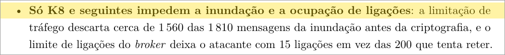
*No PDF: relatório pág. 13 (ficheiro pág. 17), §5.1.*

### R10 [menor] Pequenas imprecisões
- `06-criterio.tex:37-38` diz "4 a 5 vezes a partir de 4 KiB". A 64 KiB a razão é
  1 287/241,6 = **5,3×**. Escrever "4 vezes a 4 KiB e 5 a 64 KiB".
- `09-ameacas.tex:39` e `08-validacao.tex:58` dão a incerteza residual como "0,21 ms":
  - `saturation.csv` dá 0,208, o que está certo;
  - `calibration.md` diz 0,200;
  - uniformizar a fonte e o valor.
- `05-protecao.tex:41` (matriz: 200 ligações → 15) e a tabela de cenários (300 → 14) descrevem
  ensaios diferentes. Basta dizê-lo, para o leitor não pensar que é uma contradição.
- `03-metodo.tex:60-61` diz "os sensores e o atacante noutras máquinas da rede local". Escrever
  "noutra máquina": é só uma, como dizem a §3.1 e a ameaça "Uma só máquina de carga".

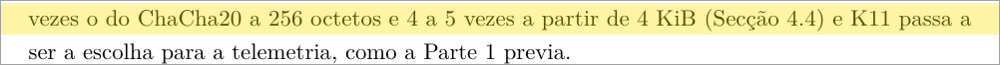
*No PDF: relatório pág. 16 (ficheiro pág. 20), §6.*

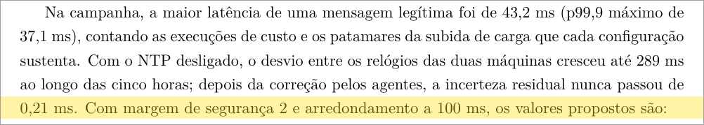
*No PDF: relatório pág. 18 (ficheiro pág. 22), §8.3.*

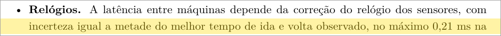
*No PDF: relatório pág. 20 (ficheiro pág. 24), §9.2.*

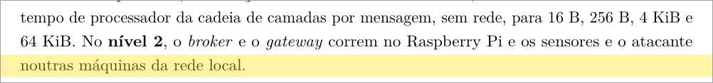
*No PDF: relatório pág. 4 (ficheiro pág. 8), §3.1.*

### R8 [importante] Tabelas escritas à mão
O `README.md` da Parte 2 estabelece que "nenhum número é escrito à mão". No entanto, duas tabelas
são manuais:
- a tabela de saturação (`04-custo.tex:90-113`);
- a tabela de cenários (`05-protecao.tex:55-117`).

O erro de R4 mostra o risco.

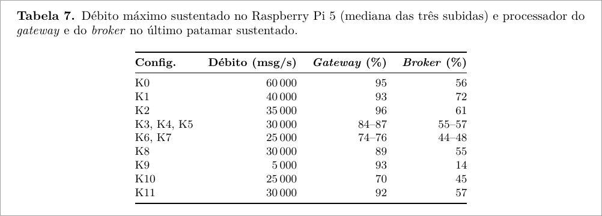
*No PDF: relatório pág. 11 (ficheiro pág. 15), §4.3, Tabela 7.*

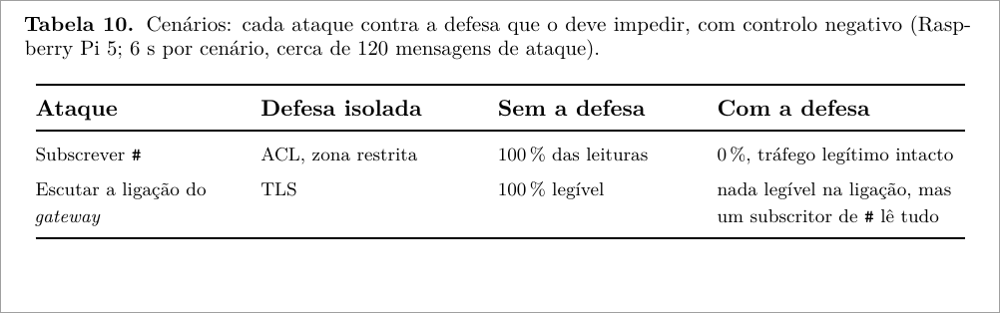
*No PDF: relatório pág. 13 (ficheiro pág. 17), §5.2, Tabela 10 (início).*

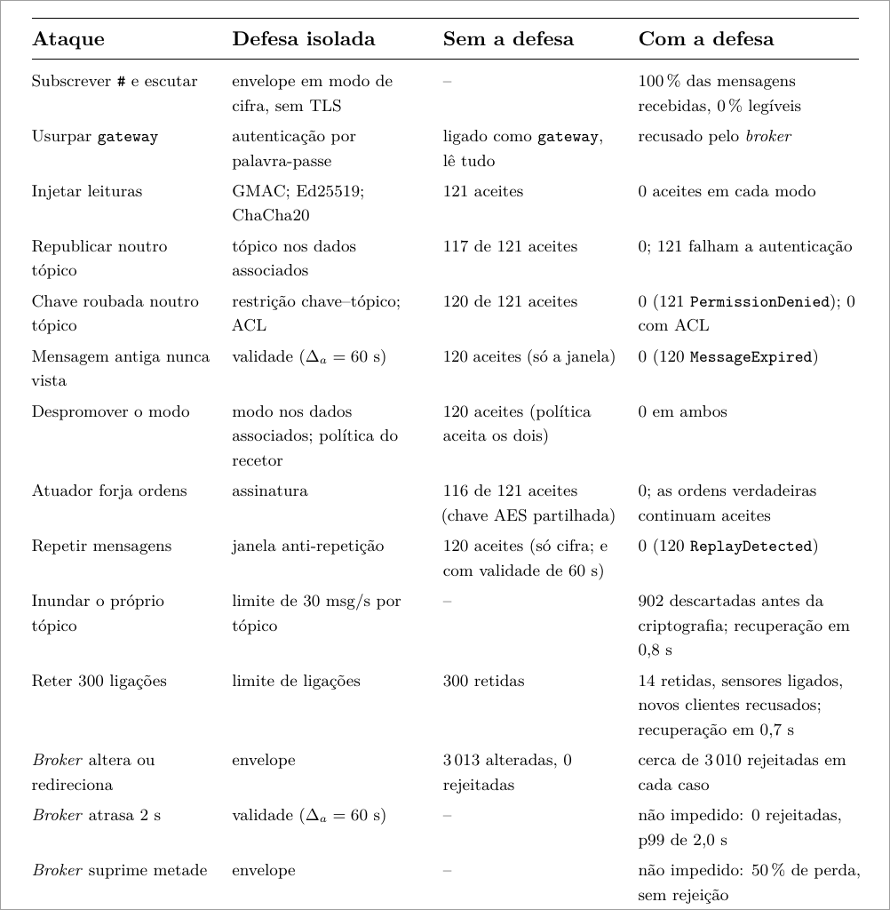
*No PDF: relatório pág. 14 (ficheiro pág. 18), §5.2, Tabela 10 (continuação).*

**Correção:**
- gerar `gerado/pi5/saturation.tex` em `tools/analysis/analyze.py`, com a mediana das 3 subidas e
  a mesma regra (perda < 1 % e p99 ≤ L_max);
- idealmente, gerar também a tabela de cenários a partir de `scenarios.csv`;
- em alternativa mínima, indicar a fonte (`saturation.csv`) na legenda.

---

## 3. Coerência com a Parte 1

Está correto:
- as remissões para §6.1, 6.3–6.9, 6.11, 7.5 e para as Secções 6 e 7;
- QP1–QP5, palavra a palavra iguais à §7.1;
- H1–H5, iguais à §7.6;
- a lacuna L5, que existe na §8.1;
- os 13 ataques e as 12 configurações.

### R3 [importante] H4 refutada sem discutir a fonte
Na Parte 1, H4 diz "como observado em [10]" (`prantl2021performance`). Na Parte 2, H4 é refutada
sem citar esse artigo nem explicar a diferença. É o resultado mais interessante do trabalho, e é
aqui que um avaliador procura a comparação com outros trabalhos.

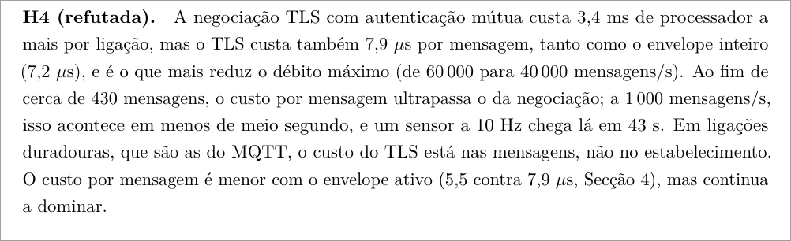
*No PDF: relatório pág. 17 (ficheiro pág. 21), §7, parágrafo de H4. Sem citação nem condição.*

**Correção:**
- em `07-hipoteses.tex`, no parágrafo de H4, citar `prantl2021performance`;
- explicar a diferença:
  - no estudo citado, ligações curtas ou com pouco tráfego por ligação;
  - aqui, ligações MQTT duradouras a 1 000 msg/s;
  - a negociação amortiza-se ao fim de ~430 mensagens;
- repetir uma frase nas conclusões.

#### R3.1 Quando é que a ligação volta a ser estabelecida — H4 é condicional

**Não há uma cadência por omissão.** Uma ligação mTLS sobre MQTT mantém-se aberta enquanto a
ligação TCP estiver viva:
- **TLS 1.3:** a renegociação deixou de existir. O `KeyUpdate` troca as chaves de sessão só com
  criptografia simétrica, sem novo *handshake* nem certificados, e só acontece a pedido de uma das
  partes.
- **Keep-alive do MQTT:** é de 30 s no protótipo (`modules/mqtt/include/msec/mqtt/connection_options.hpp:33`
  e `tools/loadgen/sensors.py:109`). Só envia `PINGREQ`/`PINGRESP` quando a ligação está parada, e
  não religa nada. O broker só desliga o cliente ao fim de 1,5 × keep-alive sem tráfego.
- **No laboratório:** cada ligação dura a execução inteira. Há um único *handshake* para dezenas de
  milhares de mensagens, e é por isso que H4 sai refutada.

**Causas reais de religação:**
- falhas de rede, ou o broker expulsar o cliente por timeout do keep-alive;
- reinício do broker ou do dispositivo, e atualizações;
- timeouts de NAT, firewalls ou balanceadores de carga em ligações paradas;
- troca de certificado ou revogação (no laboratório, uma revogação em mTLS reinicia o broker);
- **dispositivos a bateria que ligam, publicam e desligam:** cada mensagem paga um *handshake*
  completo.

**Ponto de equilíbrio, calculado com os números da campanha:**
- *handshake* mTLS: 3,41 ms de processador a mais do que sem TLS (4,2 contra 0,8 ms).
  Fontes: `hypotheses.md` e `marginal.csv`, `connect_cpu_ms` de K0→K1;
- TLS por mensagem: 7,9 µs (`marginal.csv`, `gw_cpu_us_per_msg` de K0→K1: 7,865);
- custo total do TLS por mensagem, para *n* mensagens por ligação: 7,9 µs + 3,41 ms / *n*;
- **ponto de equilíbrio: *n* ≈ 3,41 ms / 7,9 µs ≈ 430 mensagens por ligação.** Abaixo, o custo
  está sobretudo no estabelecimento; acima, está sobretudo nas mensagens.

| Padrão de uso | Mensagens por ligação | TLS por mensagem | Parte do *handshake* | Onde está o custo |
|---|---|---|---|---|
| Gateway a 1 000 msg/s, ligação permanente | milhões (430 em 0,4 s) | ≈ 7,9 µs | < 1 % | mensagens |
| Sensor a 10 Hz, ligação permanente | 430 em 43 s, depois muitas mais | → 7,9 µs | → 0 | mensagens |
| Sensor a 1 msg/min, ligação permanente | 430 em ~7 h | → 7,9 µs | → 0 a longo prazo | mensagens |
| Sensor a 1 msg/min que religa todas as horas | 60 | ≈ 65 µs | ≈ 88 % | estabelecimento |
| Dispositivo que liga, publica e desliga | 1 | ≈ 3,4 ms | ≈ 99,8 % | estabelecimento (~430×) |

**Veredicto proposto para H4:** "Refutada para ligações duradouras, como as deste trabalho. A
hipótese mantém-se quando cada ligação transporta menos de cerca de 430 mensagens."

**Texto proposto para `07-hipoteses.tex` (parágrafo de H4):** "Em ligações MQTT duradouras, o
custo do TLS está nas mensagens. A negociação com autenticação mútua (3,4 ms de processador a
mais) equivale a cerca de 430 mensagens (7,9 µs cada). O custo concentra-se no estabelecimento da
ligação apenas quando cada ligação transporta menos mensagens do que isso, como acontece em
dispositivos que religam com frequência ou que ligam, publicam e desligam [prantl2021performance]."

**Frase proposta para as conclusões:** "H4 é refutada para ligações duradouras; mantém-se abaixo
de cerca de 430 mensagens por ligação."

**Atenção:** antes de atribuir ao estudo de `prantl2021performance` ligações curtas ou poucas
mensagens por ligação, **confirmem no artigo** em que condições foi feita a medição. Esta revisão
não leu o artigo; é só a hipótese que explicaria a diferença.

**Ressalvas a escrever junto (e a pôr em "Trabalho futuro"):**
- os 4,2 ms foram medidos no processador do gateway (Cortex-A76), do lado do cliente;
- não foi medido o custo do *handshake* no broker;
- não foi medido o custo num dispositivo restrito real: num microcontrolador, um *handshake* com
  certificados ECDSA pode custar centenas de milissegundos. Como o custo por mensagem também
  muda, o ponto de equilíbrio tem de ser recalculado nessa plataforma;
- não foi medida a retoma de sessão do TLS 1.3 (PSK), que reduz o custo das religações.

**Opcional:** passar a tabela acima para o relatório, ou pôr uma figura do custo do TLS por
mensagem (7,9 µs + 3,41 ms / *n*) em função de *n*, em escala logarítmica, com o ponto de
equilíbrio marcado. Também reforça "Tabelas e Figuras" e o uso de equações (R7).

### R7 [importante] Equações do critério
A Parte 1 define S(c) (Eq. 10), custo(c) (Eq. 11) e c* (Eq. 12). O critério "uso adequado de
equações" foi avaliado nessa parte. A Parte 2 usa S, custo e Δcusto/ΔS sem mostrar as equações.

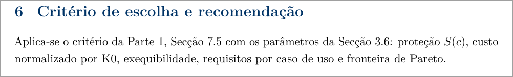
*No PDF: relatório pág. 15 (ficheiro pág. 19), início da §6. O critério é aplicado sem mostrar as equações.*

**Correção:**
- em `06-criterio.tex`, repetir as três equações, numeradas e com a remissão "(Parte 1, Eq. 10–12)";
- nas Interações (§4.2), escrever a diferença das diferenças como equação, por exemplo
  (K7−K10) − (K1−K0).

### R11 [menor] Remissões vagas para a Parte 1
- `03-metodo.tex:65,109` usa "\PUm{Tabela das configurações}" e "\PUm{Tabela dos ataques}".
  Escrever "Parte 1, Tabela 14" e "Parte 1, Tabela 16".
- Os ataques A1–A13 não têm esses números na Parte 1:
  - dizer uma vez, na §3.4, que A1–A13 numeram as linhas da Tabela 16;
  - usar os nomes em português na legenda da matriz (ver R13).

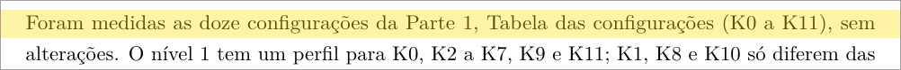
*No PDF: relatório pág. 4 (ficheiro pág. 8), §3.2.*

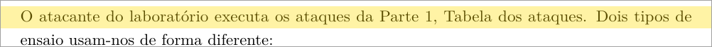
*No PDF: relatório pág. 4 (ficheiro pág. 8), §3.4.*

---

## 4. Texto, tabelas e figuras

### R12 [menor] Legendas que terminam em "(—)"
As duas tabelas de `gerado/pi5/summary.tex` terminam em "execuções (—).". A causa é o "Contexto"
da campanha estar vazio (`hypotheses.md` diz "Contexto: —"). Corrigir em `analyze.py`, omitindo o
contexto quando está vazio, ou preencher o contexto.

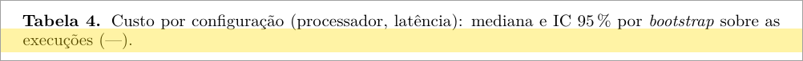
*No PDF: relatório pág. 8 (ficheiro pág. 12), §4.1, legenda da Tabela 4. A Tabela 5 tem o mesmo problema.*

### R13 [menor] Inglês e ponto decimal nas tabelas geradas
- A legenda da matriz de proteção usa os identificadores em inglês (`eavesdrop-network`,
  `stolen-key-other-topic`…).
- `microbench.tex` usa ponto decimal (`0.82`) e "4096 B", enquanto o texto usa vírgula e "4 KiB".
- Correção: traduzir os nomes e usar a vírgula decimal no gerador (ou `siunitx` com
  `output-decimal-marker={,}`).

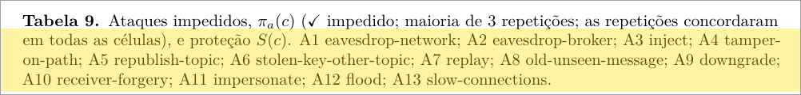
*No PDF: relatório pág. 13 (ficheiro pág. 17), §5.1, legenda da Tabela 9.*

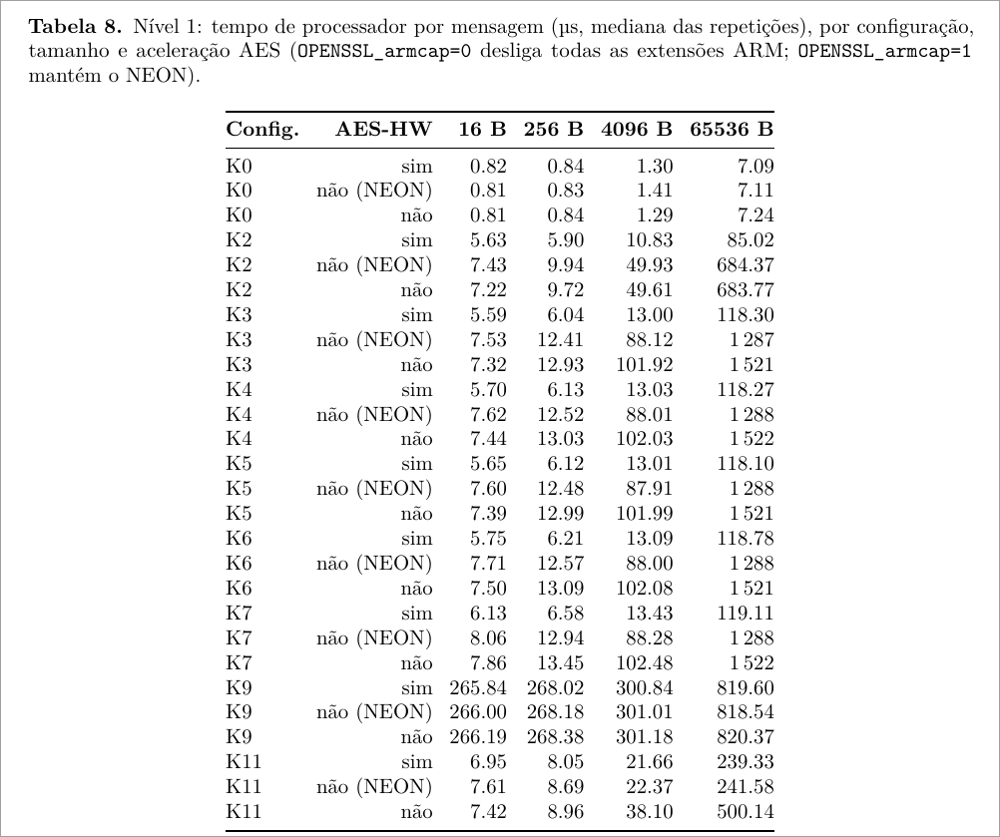
*No PDF: relatório pág. 12 (ficheiro pág. 16), §4.4, Tabela 8. Ponto decimal e 4096 B / 65536 B.*

### R14 [menor] Tabelas e figura nunca referidas no texto
- `tab:criterio` (§6): por exemplo, "A Tabela~\ref{tab:criterio} dá…".
- `tab:hipoteses` (§7): por exemplo, "A Tabela~\ref{tab:hipoteses} resume…".
- A figura de Pareto também não é referida.

*Sem captura: o problema é a ausência de uma remissão no texto, não algo visível numa página.*

### R15 [menor] Salto de latência a 400 msg/s por sensor
- Está descrito duas vezes: na §4.3 (p99 de 20–35 ms) e na §9 (p50 de 7–14 ms).
- Manter os números num só sítio e, no outro, remeter para ele.
- Uma figura de p99 em função da carga (a partir de `saturation.csv`) tornaria o salto e a
  saturação muito mais legíveis. O critério da Parte 1 valoriza "Tabelas e Figuras".

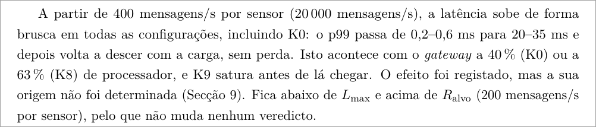
*No PDF: relatório pág. 10 (ficheiro pág. 14), §4.3.*

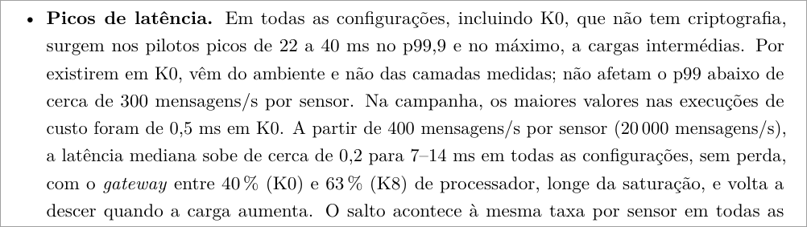
*No PDF: relatório pág. 20 (ficheiro pág. 24), §9.2, «Picos de latência».*

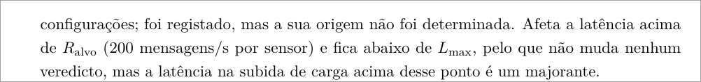
*No PDF: relatório pág. 21 (ficheiro pág. 25), §9.2, continuação.*

### R16 [menor] Resumo
Cumpre o limite de ½ página e não tem referências. Sugestões:
- dizer que é uma avaliação experimental com 120 execuções, 468 ataques e 39 cenários;
- trocar "como a primeira parte previa" por "confirmando a recomendação da primeira parte".

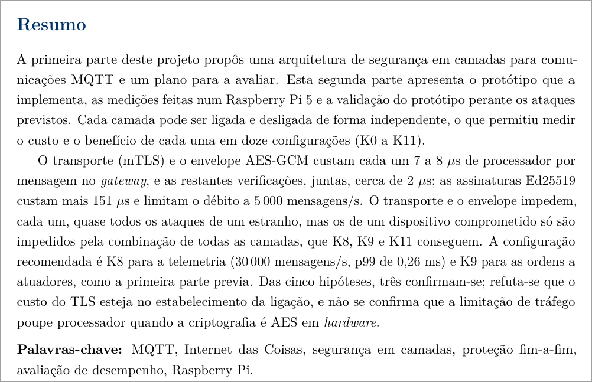
*No PDF: relatório pág. i (ficheiro pág. 2), Resumo.*

### R17 [menor] Frases longas
Têm frases de 4–5 linhas, que convém partir em duas:
- §3, "Relógios" (l. 44-55);
- §3.8, "Campanhas repetidas" (l. 222-237);
- §6 (l. 34-39).

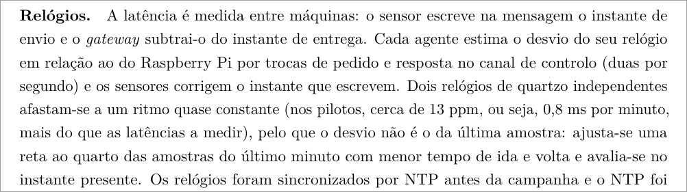
*No PDF: relatório pág. 4 (ficheiro pág. 8), §3.1, «Relógios». Um só parágrafo com frases muito longas; continua na página.*

### R18 [menor] Unidades
Os MB são KB/1000 (7 520 KB → "7,5 MB"). Está certo, mas convém declarar uma vez que
MB = 10⁶ B, ou usar MiB de forma consistente.

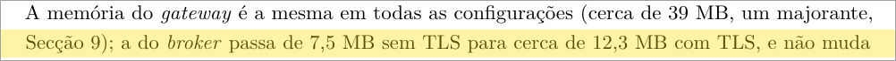
*No PDF: relatório pág. 11 (ficheiro pág. 15), §4.5.*

---

## Tarefas no código para mais tarde (fora do relatório)

### T1 Retirar a dependência do Wireshark do código
**Porquê:** o Wireshark não é usado nas medições. Na campanha, o `manifest.json` regista
`"capture": null` e `"keylog": null`, e a escuta e o broker ativo são medidos em Python, por
`tools/loadgen/relay.py`. Mesmo assim, a dependência:
- obriga a instalar o `tshark` (CI, Docker);
- faz 7 testes aparecerem como ignorados no Pi (R5);
- acrescenta um alvo de compilação.

Inventário do que existe hoje, levantado com
`grep -rli "wireshark|tshark|keylog|--capture|pcapgen"`, excluindo `results/`, `report/` e `.git/`:

**Remover:**
- [ ] `tools/wireshark/`, inteiro: `msec.lua` (dissetor), `sslkeylog.cpp` (*shim* de segredos
  TLS), `CMakeLists.txt` e `README.md`.
- [ ] `tools/loadgen/capture.py` (`dumpcap`/`editcap`), `tools/loadgen/keylog.py` e
  `tools/loadgen/pcapgen.py`.
- [ ] `tools/loadgen/tests/test_wireshark.py` (os 7 testes).

**Adaptar:**
- [ ] `CMakeLists.txt:64`: retirar `add_subdirectory(tools/wireshark)`.
- [ ] `run.sh`: retirar `--capture` (l. 7) e o alvo `msec_sslkeylog` (l. 30).
- [ ] `tools/loadgen/loadgen.py`: retirar as opções `--capture` e `--keylog` e o `start_capture`
  (l. ~111, 138, 211, 270, 393-399).
- [ ] Retirar `import keylog` e as chamadas correspondentes:
  - `tools/loadgen/lab.py:52,519` (o argumento do *shim* passado ao `Broker`);
  - `broker.py:40,86,94,156`;
  - `gateway.py:13,48`;
  - `sensors.py:39,60,65`;
  - `agent.py:31,174`;
  - `cluster.py:47,186`.

  Nos clientes Python, `keylog.enable(context)` passa a ser só `context`, e o resto do TLS
  continua igual.
- [ ] `lab.py:469`: o comentário "(e.g. Capture.mark)" sobre os *listeners*. Verificar se há mais
  usos de `Capture`.
- [ ] `.github/workflows/ci.yml:18,26`: retirar o `tshark` dos pacotes instalados e renomear o
  passo "Load-lab and Wireshark tooling tests".
- [ ] `docker/Dockerfile:6,24,30,59,69`: retirar o `tshark`, a cópia de `tools/wireshark` e a do
  `libmsec_sslkeylog.so`.
- [ ] Documentação: `README.md`, `docs/README.md`, `docs/SDD.md`, `docs/build-system.md`,
  `docs/evaluation.md`, `docs/getting-started.md`, `docs/testing.md`,
  `docs/loadgen/components.md`, `docs/loadgen/overview.md`, `docs/security/threat-model.md`,
  `docs/plano-parte2.md`. Ponderar retirar `docs/network-analysis.md` inteiro, porque é sobre a
  análise com Wireshark.

**Não confundir:**
- o contador `captured` (`cluster.py:435`, `lab.py:871`) conta mensagens capturadas pelo atacante,
  não capturas Wireshark: fica;
- o `relay.py`, intermediário em Python, é o instrumento de medição: fica.

**O que se perde (registar em `docs/SDD.md`, limitação L14):** o `test_tls12_is_really_tls12` era
o único teste que confirmava que um laboratório configurado para TLS 1.2 negoceia mesmo TLS 1.2. O
Mosquitto só trata `tls_version` como mínimo, e o máximo é limitado por `OPENSSL_CONF`. Se essa
garantia ainda interessar, pode ser substituída por um teste em Python que se ligue ao broker com
`ssl` e verifique `SSLSocket.version()`, sem Wireshark. O relatório da Parte 2 não depende dela.

**Depois de retirar:**
- [ ] Compilar os presets (`cmake --preset dev`, `bench`).
- [ ] Correr os testes C++ e Python, localmente e na CI.
- [ ] Correr no Raspberry Pi
  `tools/loadgen/.venv/bin/python -m unittest discover -s tools/loadgen/tests -t tools/loadgen -v`
  e guardar a saída, com `uname -a` no início, num registo novo em `results/validation/`. Deve
  dar `Ran 54 tests … OK`, sem testes ignorados.
- [ ] Atualizar no relatório o caminho do registo (`08-validacao.tex`) e o commit, se mudar.
  Atenção: a campanha foi medida com o commit `79c4878`. Os testes no commit novo validam o código
  sem Wireshark, e o relatório deve distinguir os dois commits, ou manter o registo antigo e
  acrescentar o novo.
