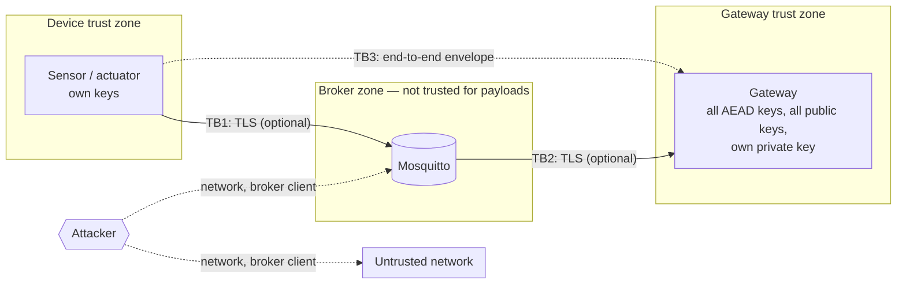

# Threat model and security analysis

This document states what mqtt-secure protects, against whom, how, and what
remains possible. It is the basis for the security sections of the
[SDD](../SDD.md#8-security-design).

## 1. System and trust boundaries

| Boundary | Crossed by | Protected by |
|---|---|---|
| TB1 device ↔ broker | MQTT connection | TLS / mTLS, passwords |
| TB2 broker ↔ gateway | MQTT connection | TLS / mTLS, passwords |
| TB3 device ↔ gateway | payload | envelope (AEAD / signature), freshness, replay window, key binding |
| broker internal | routing to subscribers | ACL, client-id binding |

## 2. Assets

| Asset | Properties needed |
|---|---|
| Sensor readings (uplink) | confidentiality (optional per deployment), integrity, authenticity, freshness |
| Actuator commands (downlink) | integrity, authenticity, freshness, no replay — safety critical |
| Payload keys (AES, Ed25519) | confidentiality, integrity |
| MQTT credentials, client certificates | confidentiality |
| Gateway / broker availability | availability under flood |

## 3. Adversaries

| ID | Adversary | Capabilities |
|---|---|---|
| A1 | Passive network observer | reads all traffic on the wire |
| A2 | Active network attacker | modifies, drops, replays, injects packets |
| A3 | Rogue broker client ("mallory") | connects to the broker (if allowed), subscribes `#`, publishes, replays; knows the public CA certificate |
| A4 | Impersonator | claims another client's id or username |
| A5 | Curious / compromised broker | sees and can alter every payload it routes |
| A6 | Compromised device | holds one device's valid keys and credentials |
| A7 | Flooder | sends at high rate, possibly to a victim's topic |
| A8 | Holder of a shared key (incl. the gateway itself) | can compute AEAD tags for that key |

## 4. Threats and controls (STRIDE)

| # | STRIDE | Threat | Adversary | Control | Residual risk |
|---|---|---|---|---|---|
| T1 | I | Read payloads on the wire | A1 | TLS; `encrypt` | none with either |
| T2 | I | Read payloads via `#` subscription | A3 | ACL (restricted zone); `encrypt` | metadata (topic, size, timing) visible in open zone |
| T3 | I | Broker reads payloads | A5 | `encrypt` (TLS terminates at the broker) | metadata |
| T4 | T | Modify payload | A2, A3, A5 | GCM tag / Ed25519 | none |
| T5 | T | Modify header (seq, timestamp, key id, mode) | A2, A3, A5 | header in AAD | none |
| T6 | T | Move a valid message to another topic | A3, A5 | topic in AAD; ACL | none |
| T7 | S | Inject forged messages | A3 | envelope + authentication; ACL write rules | none without a key |
| T8 | R/S | Replay captured messages | A2, A3, A5 | sequence + 64-entry window; freshness | replays possible after **receiver restart** within 60 s |
| T9 | T | Deliver stale / pre-recorded messages | A2, A5 | freshness window (60 s age, 5 s future skew) | messages ≤ 60 s old if replay window off |
| T10 | T | Downgrade protection (encrypt → auth_only) | A6, A8 | mode authenticated + receiver accept set | none |
| T11 | S | Impersonate gateway/other client at the broker | A4 | passwords; mTLS with CN = username; `use_username_as_clientid` | without auth, a username is only a claim (`impersonate-no-auth`) |
| T12 | S | Session takeover by reusing another's client id | A4 | client-id binding | — |
| T13 | S/E | Compromised device publishes as another device | A6 | `KeyTopicPolicy` (`+/sensors/%u/#`); ACL `restricted/sensors/%u/#` | — |
| T14 | S | Compromised device sends false data **on its own topics** | A6 | revocation after detection | **undetectable by crypto** |
| T15 | R | Key holder (gateway) fabricates device data | A8 | `sign`: gateway holds only public keys | in AEAD modes the gateway can forge |
| T16 | S | Compromised actuator forges downlink commands to peers | A6 | `sign` on downlink (actuators hold only gateway public key) | **in AEAD modes the downlink key is a group key** |
| T17 | I/S | Stolen keys used later | A6 | rotation (epochs, 3 s grace, never reuse ids), revocation (keys, passwords, CRL) | window between theft and rotation/revocation |
| T18 | D | Flood a topic | A7 | per-topic token bucket before crypto; `max_packet`; `max_connections` | victim's topic budget is shared with the attacker; broker itself not rate-limited per client |
| T19 | D | Exhaust gateway memory with fake key ids / topics | A3, A7 | bounded `ReplayGuard` (only after auth), bounded rate buckets with overflow bucket, bounded repository | — |
| T20 | I | Verification oracle (learn why a message failed) | A3 | uniform `AuthenticationFailed`; replay state only moves after auth; policy checked only after auth | timing differences between pre-crypto checks are observable (by design: they reveal nothing secret) |
| T21 | I | Secrets left in memory | local | `SecureBuffer` zeroing; plaintext wiped after sealing and on rejection | copies made by third-party libraries (OpenSSL, Paho) |
| T22 | S | Malicious lab controller / agent | lab | pinned fingerprint before sending anything; token (constant-time); CSR enrolment (sensor private keys never leave agents); 0700 temp dirs | dashboard has no authentication (local bind only) |

## 5. Security properties per configuration

| Configuration | Conf. | Integ. | Origin to 3rd party | Replay | Insider confined | Notes |
|---|---|---|---|---|---|---|
| no payload protection, no TLS | ✘ | ✘ | ✘ | ✘ | ✘ | baseline |
| TLS only | wire only | wire only | ✘ | ✘ | ✘ | broker sees everything |
| `auth_only` + freshness + replay | ✘ | ✔ | ✘ | ✔ | with binding | payload readable by subscribers |
| `encrypt` (defaults) | ✔ | ✔ | ✘ | ✔ | with binding | recommended default |
| `sign` + freshness + replay + binding | ✘ | ✔ | ✔ | ✔ | ✔ | gateway cannot forge; ~40× CPU |
| `hardened` preset | wire (mTLS 1.3) | ✔ | ✔ | ✔ | ✔ | attacker cannot even connect |

The `hardened` preset (`tools/loadgen/lab.py:hardened`): mTLS, TLS 1.3, MQTT 5,
passwords, ACL, client-id binding, no `$SYS`, `max_packet` = payload + 512,
`max_connections` = sensors + 16, `sign`, freshness, replay window, key
binding, rate limit = max(10, 2 × sensor rate + 1) per topic, restricted zone.

## 6. Why each check is where it is

- **Freshness before crypto**: rejects stale traffic cheaply; the timestamp is
  unauthenticated at that point, but a forged timestamp can only cause a
  rejection (the timestamp is in the AAD, so a message whose timestamp was
  changed to pass freshness fails authentication anyway).
- **Mode policy before crypto**: same argument — the mode is in the AAD.
- **Binding and replay after crypto**: these mutate state or reveal policy,
  which unauthenticated input must not be able to influence or probe.
- **Binding before replay**: a message refused for its topic does not consume
  its sequence number (test `RejectedBindingDoesNotConsumeTheSequenceNumber`).
- **Rate limit before everything** (transport side of the pipeline): floods
  cost no crypto.

## 7. Cryptographic considerations

- **Nonces**: random 96-bit per message. Birthday bound ⇒ keep well below 2³²
  messages per key; the lab rotates via `payload.key_epoch`.
- **Sequence space**: 2⁶⁴; the C++ sender refuses to wrap (`InvalidState`,
  "rotate key").
- **Key separation**: separate stores for AEAD keys, signing keys and
  verification keys; separate key per device; the gateway's own key id 0 (per
  epoch) is used for downlink.
- **GMAC construction (auth_only)**: AES-GCM with empty plaintext and the
  payload appended to the AAD; tag is 16 bytes.
- **Signatures**: Ed25519 is deterministic (no per-signature randomness to get
  wrong).

## 8. Assumptions that, if violated, break guarantees

1. Each key id is used by exactly one sender.
2. Key ids are never reused after revocation.
3. Clocks are within 5 s (future) and messages arrive within 60 s when
   freshness is enforced.
4. Keys are generated by a CSPRNG and distributed confidentially.
5. With `sign`, the gateway really holds no device private keys (the lab's
   `gateway_view` guarantees it; test
   `test_gateway_never_holds_sensor_private_keys`).

## 9. Evidence

Every row of section 4 maps to tests, fuzzers, scenarios or benchmark counters
in [SDD Appendix B](../SDD.md#appendix-b--threat--mechanism--evidence-traceability).
